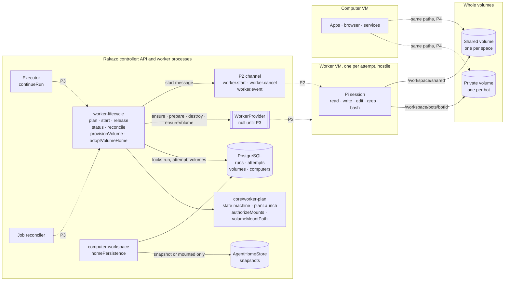
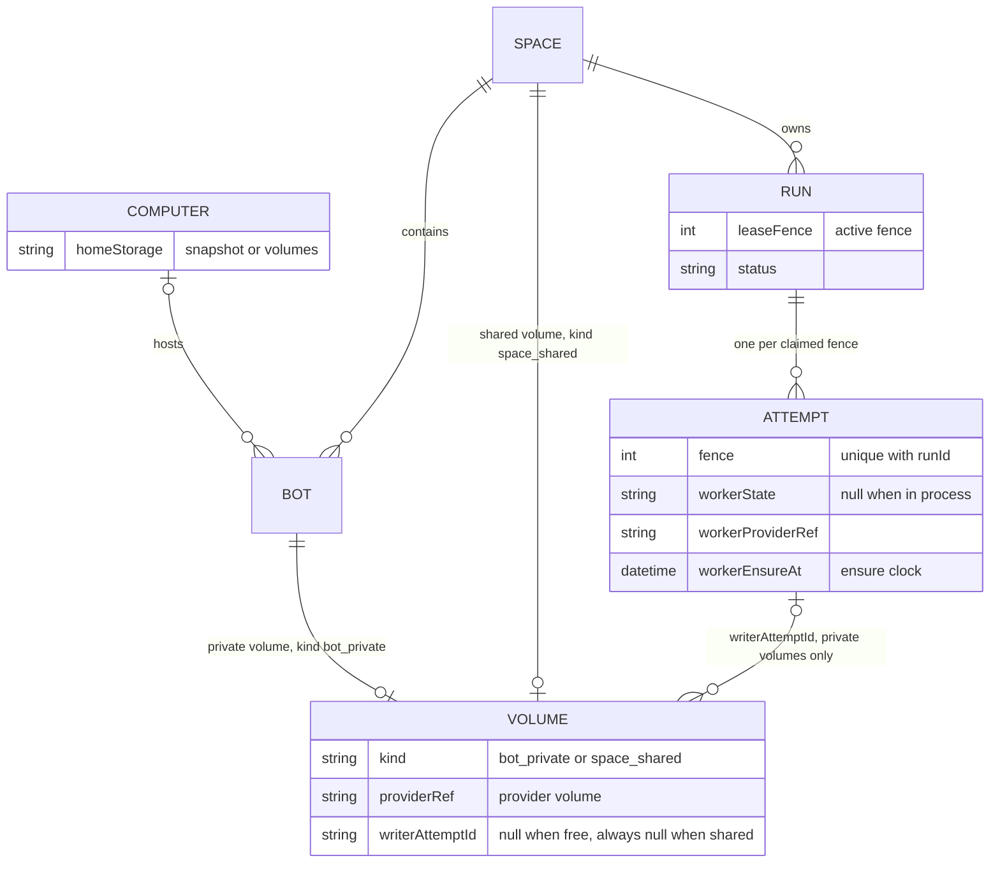
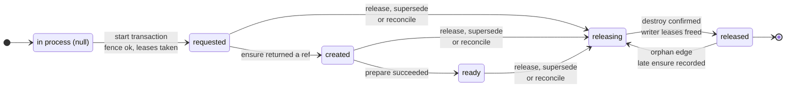
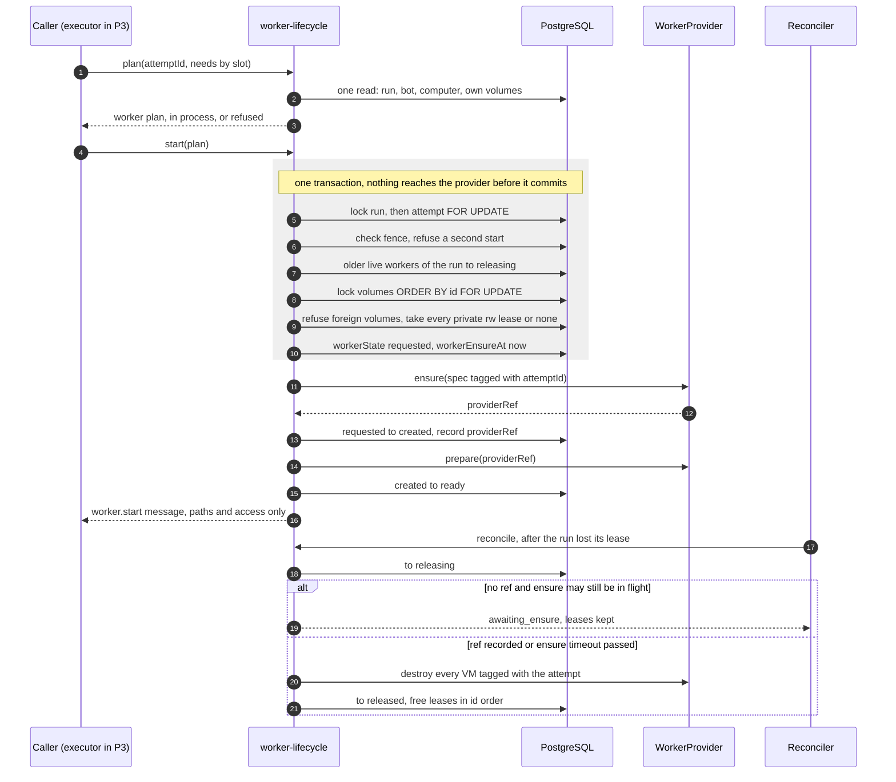

# P1 worker, attempt and volume contracts handoff

**Verdict: the contracts, the additive migration and the controller lifecycle pass their offline proofs. No product run uses a worker yet.** Every deployment still runs in process, because no worker provider is composed until P3. This slice changes one production behavior, and only for data that does not exist yet: a computer whose home moved to volumes is never imported or exported automatically.

## Integrated references

- Feature base: `feature/pi-e2b-workers` at `af6940d24`. It contains P0 ([#204](https://github.com/RomainJeff/rakazo-bot/pull/204)) and `main` at `85abeb7fc`.
- P0 handoff: [P0-handoff.md](P0-handoff.md). P1 consumes its SDK verdict and limits unchanged.
- Infrastructure documentation reference: `09f242991ada8fdab2a9ce7a1fa847671d511874`. I1 has not started. The volume names, mount paths and rights below are the P1 proposal that I1 validates or rejects.
- Slice branch: `codex/pi-e2b-p1-contracts`. The tested commit is recorded in the [verification receipt](evidence/P1/verification.json).

## What P1 adds

| Layer | File | Content |
| --- | --- | --- |
| Policy | `packages/core/src/worker-plan.ts` | Worker state machine, `RunNeeds`, `planLaunch`, `authorizeMounts`, `volumeMountPath`, `homePersistence`, `WORKER_SUPPORT`, `WORKER_TTL_SECONDS`. Pure, no I/O. |
| Vocabulary | `packages/contracts/src/ids.ts` | `WorkerState`, `VolumeKind`, `VolumeAccess`, `HomeStorage` enums. |
| Wire | `packages/adapter-kit/src/worker-protocol.ts` | Version 1 messages and `parseWorkerMessage`. |
| Provider | `packages/adapter-kit/src/worker-provider.ts` | `WorkerProvider`, `WorkerSpec`, `WorkerCapabilities`. |
| Database | `packages/db/prisma/migrations/20261019120000_*` to `20261019120005_*` | Worker columns on `attempts`, the `volumes` table, `computers.homeStorage`, four indexes on `attempts` built concurrently, and the validation of the two new checks in their own migration. |
| Controller | `packages/adapters/src/worker-lifecycle.ts` | `createWorkerLifecycle` with `plan`, `start`, `release`, `status`, `reconcile`, `provisionVolume` and `adoptVolumeHome`. It is the only writer of `attempts.worker*`, `volumes.writerAttemptId` and `computers.homeStorage`. |
| Home switch | `packages/adapters/src/computer-workspace.ts` | Restore and checkpoint ask `homePersistence` how a home persists. |
| Test double | `packages/adapters/src/fake-worker-provider.ts` | Deterministic provider that records every call. |

## Architecture

The controller owns every decision. The worker VM runs Pi and its native tools on the mounted volumes and never sees a volume id, an owner or a host path. P1 delivers the parts drawn in solid lines. Dashed lines are wired by later slices.



### Durable model

Worker state lives on the existing `attempts` row: one VM serves one attempt. `volumes` is the only new table. The active fence stays `runs.leaseFence`.



### Worker lifecycle

A null `workerState` means the attempt runs in process, which covers every historical attempt. Leases free only on the `releasing` to `released` edge, after the provider confirms the VM is gone.



### Start and release

`start` decides ownership and takes the writer leases in one transaction, before any provider call. A `release` that meets an `ensure` still in flight keeps the leases until the VM is found and destroyed.



## Identity, fence and ownership

A worker belongs to one `Attempt`. The attempt id is the worker id, and one VM serves one attempt. Run id, attempt id, fence and provider reference therefore live on one row.

The active fence stays `runs.leaseFence`. An attempt holds its run when `attempt.fence` equals `run.leaseFence` and the run status is `leased` or `running` (`attemptHoldsFence`). P1 stores no second fence. The new unique index `attempts_runId_fence_key` makes `(runId, fence)` name exactly one attempt.

`runs.leaseOwner` is a process id or `"api"`. It is not an identity across machines. Remote messages carry the attempt id and the fence, never the owner.

The controller decides ownership. A run asks for slots, never for volume ids:

```ts
type RunNeeds = {
	files: { private: "rw" | "ro" | null; shared: "rw" | "ro" | null };
	computer: "none" | "on_use";
};
```

`plan` fills the private slot with the run's bot volume and the shared slot with the run's space volume. A foreign volume cannot be named at plan time. `start` checks every grant again inside its transaction, before any provider call. It refuses a private volume of another bot and a shared volume of another space.

## Worker state machine

Each transition is a compare-and-set on `attempts.workerState`. A null state means the attempt runs in process, which covers every historical attempt.

| From | To | Written by | Effect |
| --- | --- | --- | --- |
| null | `requested` | `start` transaction | Writer leases taken. Older live workers of the same run move to `releasing`. `workerEnsureAt` records when `ensure` may start. |
| `requested` | `created` | `start`, after `provider.ensure` | Provider reference recorded before any fallible setup. |
| `created` | `ready` | `start`, after `provider.prepare` | The start message is returned. |
| `requested`, `created`, `ready` | `releasing` | `release`, `start` supersede, `reconcile` | The VM may still run. Leases stay held. |
| `releasing` | `released` | `release`, after `provider.destroy` returns | Same transaction clears `volumes.writerAttemptId` for the attempt. |
| `released` | `releasing` | `start`, when its late `ensure` returns a VM for a released worker | The orphan edge. It records the VM so `reconcile` can destroy it. It needs an `ensure` that outlived its timeout. |
| `released` | none | none | Otherwise terminal. A second `release` calls no provider. |

The database enforces two rules. `attempts_worker_shape_check` refuses `created` or `ready` without a provider reference. `attempts_runId_live_worker_key` allows at most one `requested`, `created` or `ready` worker per run.

Pausing a run for input or takeover ends its attempt. The worker is released, and a resumed run gets a new attempt and a new VM.

## Ownership protocol

Four actors can move the same attempt: its `start`, `release`, `reconcile`, and the `start` of a newer attempt that supersedes it. Five rules keep them from freeing a lease under a live VM or losing a VM.

1. Every transaction locks in one order: the run row, then the attempt row with `FOR UPDATE`, then volume rows in ascending id. `start` checks the attempt state only after it holds the attempt lock.
2. An attempt has exactly one `start`. The start transaction requires a null worker state, so a second call throws `StaleAttemptError` before any provider call. A controller that crashes during `start` loses its run lease, and the next claim gets a new fence and a new attempt.
3. `start` releases the worker only when its own `ensure` or `prepare` fails.
4. A provider that answers `absent` for a worker without a reference proves nothing while its `ensure` may still create the VM. `release` then moves the worker to `releasing`, keeps its leases and returns `awaiting_ensure` (`ensureMayBeInFlight`, read from `workerEnsureAt`). After `WORKER_ENSURE_TIMEOUT_SECONDS` (15 minutes), the next `reconcile` destroys by attempt tag and frees the leases. `WorkerSpec.ensureDeadline`, `workerEnsureAt` plus that timeout, forbids the provider to create the VM after that instant.
5. When `start` cannot record its VM because another actor moved the attempt, it hands the VM to that actor. A `releasing` worker without a reference gets the reference, and `release` destroys it at once. A `released` worker takes the orphan edge back to `releasing` with the reference, then `start` tries `release`. If that destroy fails, `reconcile` finds the row.

A `release` that runs while the start transaction is still open sees no worker yet and returns `not_live`, and that `start` goes on to `ready`. `reconcile` releases that worker on its next pass, because its run no longer holds the lease. P3 must not treat `not_live` as proof that no VM exists.

`release` returns `released`, `awaiting_ensure` or `not_live`. `reconcile` returns how many workers it released, how many still wait for an `ensure`, and how many failed. A destruction the provider cannot confirm leaves the worker in `releasing`, with its leases, for the next pass. Each pass moves `workerStateAt`, so a row that keeps failing does not block the rows behind it.

## Volumes, paths and rights

| Volume | Rows | Guest path | Provider name |
| --- | --- | --- | --- |
| Private, one per bot | `kind = 'bot_private'`, unique by `botId` | `/workspace/bots/<botId>` | `rakazo-<volumeId>` |
| Shared, one per space | `kind = 'space_shared'`, unique by `spaceId` | `/workspace/shared` | `rakazo-<volumeId>` |

`volumeMountPath` is the only source of guest paths. It refuses a bot id that is not a single safe path segment. The paths are identical in every VM that mounts the volume, and the worker's working directory is the private mount when it has one. The guest never receives a volume id, a provider reference, an owner id or a host path. Its start message lists only path, scope and access.

Volumes are whole volumes. There is no `subPath`. A run that needs no files mounts nothing.

The `ro` right exists in the contract. `authorizeMounts` refuses it when the provider reports `readOnlyMounts: false`. The E2B SDK mount (`SandboxVolumeMount { name, path }` in `e2b@2.49.1`) has no read-only flag, so `ro` stays refused on E2B unless I1 enforces it below the mount API.

## Writer lease

`volumes.writerAttemptId` is the single writer of a writable private volume. `takesWriterLease` is the only source of that rule: a mount takes a lease when it is `rw` and private. `start` takes every such lease in one transaction that locks the volume rows with `ORDER BY id FOR UPDATE`. If one volume is busy, the transaction rolls back and `start` throws `VolumeBusyError`. Nothing stays held, including the supersede of older workers, and the caller requeues with the existing backoff. `release` locks the volumes it frees in the same order, after the attempt. Every transaction follows the lock order of the ownership protocol, so two of them cannot wait on each other.

A lease frees only in the transaction that records confirmed destruction. A run clock never frees it, because a hostile VM can keep writing after its run lease expires. A failed `ensure` keeps the lease for up to the ensure timeout, because its VM may still appear. `WorkerSpec.ttlSeconds` bounds a VM whose destruction is never confirmed: after the TTL the provider reports it `absent`, and the next `release` frees the lease. `WORKER_TTL_SECONDS` is four hours. P3 confirms or changes that value.

The shared volume takes no lease. Every bot of the space may write `/workspace/shared` at once, and its `writerAttemptId` stays null. The private lease exists to fence a run from its own stale attempt, because NFS has no atomic fence. Two bots of one space are both legitimate writers. Serializing them blocked every file run of the space behind one worker, including a run paused for a human.

Two consequences are accepted. Concurrent writes to the same shared file follow last-write-wins, like a shared drive. A superseded or zombie VM may keep writing `/workspace/shared` until its destruction is confirmed.

The computer never holds a writer lease. Manual edits on the computer are not part of any transaction with a worker.

## Messages

All messages carry `version: 1`. Each direction has its own parser, and neither throws. `parseControllerMessage` accepts only `worker.start` and `worker.cancel`, which the guest receives. `parseGuestMessage` accepts only `worker.event`, so a guest cannot send a start or a status. Both return `{ ok: false, reason: "unsupported_version" }` for another version and `{ ok: false, reason: "invalid" }` for anything else that fails the schema, including unknown fields. A compile-time check fails the build if any message field can hold a callable.

| Kind | Direction | Content |
| --- | --- | --- |
| `worker.start` | Controller to guest | Identity, workspace `cwd` and mounts, computer mode. P2 adds the callback-free run input. |
| `worker.cancel` | Controller to guest | Identity. The controller destroys the VM whatever the guest does. |
| `worker.status` | Controller only | Projection of the attempt row: state, provider reference, active. It is in neither wire parser. |
| `worker.event` | Guest to controller | Identity and `payload: unknown`. P2 owns payloads, sequence numbers and acknowledgement. |

A start message for a bot with both volumes:

```json
{
	"version": 1,
	"kind": "worker.start",
	"worker": { "runId": "run_1", "attemptId": "attempt_1", "fence": 3 },
	"workspace": {
		"cwd": "/workspace/bots/bot_1",
		"mounts": [
			{ "path": "/workspace/bots/bot_1", "scope": "private", "access": "rw" },
			{ "path": "/workspace/shared", "scope": "shared", "access": "rw" }
		]
	},
	"computer": "on_use"
}
```

A start message for an MCP-only run:

```json
{
	"version": 1,
	"kind": "worker.start",
	"worker": { "runId": "run_2", "attemptId": "attempt_7", "fence": 1 },
	"workspace": { "cwd": "/workspace", "mounts": [] },
	"computer": "none"
}
```

No `AgentRunRequest` callback, secret, model key, OAuth credential or connector route appears in any message.

## Provider contract and capabilities

```ts
interface WorkerProvider {
	describe(): AdapterDescriptor<{ readOnlyMounts: boolean }>;
	ensure(spec: WorkerSpec, context: AdapterContext): Promise<{ providerRef: string }>;
	prepare(providerRef: string, spec: WorkerSpec, context: AdapterContext): Promise<void>;
	destroy(
		target: { attemptId: string; providerRef: string | null },
		context: AdapterContext,
	): Promise<"destroyed" | "absent">;
	ensureVolume(input: { name: string }, context: AdapterContext): Promise<{ providerRef: string }>;
}
```

- `ensure` creates the VM tagged with `spec.attemptId`, or returns the VM already tagged with it.
- `ensure` must not create the VM after `spec.ensureDeadline`.
- `destroy` removes every VM tagged with the attempt, with or without a reference. A VM already gone returns `absent`, not an error.
- `ensureVolume` creates the named volume or returns the existing one.
- The interface has no method that deletes a volume. Ending a run cannot delete one.

Only `e2b` declares worker support in `WORKER_SUPPORT`. Docker, Daytona, Box, desktop and fake computers keep their in-process path, and `adoptVolumeHome` refuses them with `computer_kind_unsupported`. The database check `computers_home_storage_check` allows `homeStorage = 'volumes'` only on an `e2b` computer. A new `SandboxKind` fails the build until it declares its support.

To support another provider, such as Docker, follow [How to add a worker provider](adding-a-worker-provider.md).

`createWorkerLifecycle({ prisma, provider: null })` answers every `plan` with `{ mode: "in_process", reason: "no_worker_provider" }` and runs no query. P3 adds the E2B worker adapter and composes it.

## Errors

| Error | Thrown by | Meaning | Caller action |
| --- | --- | --- | --- |
| `StaleAttemptError` | `plan`, `start` | The attempt no longer holds its run fence, or its worker is past `created`. | Stop. A newer attempt owns the run. |
| `VolumeRefusedError` | `start`, `provisionVolume` | A grant failed authorization. `refusal.code` is one of `volume_not_found`, `private_volume_of_other_bot`, `shared_volume_of_other_space`, `volume_not_provisioned`, `provider_mismatch` or `read_only_unsupported`. | Fail the run. Nothing was written and no provider was called. |
| `VolumeBusyError` | `start` | Another attempt still writes one of the volumes. | Requeue with backoff. Nothing is held. |

`plan` also returns `{ mode: "in_process", reason: "home_not_migrated" }` when a run needs files and its computer home is still a snapshot. P1 never mounts an empty volume over a home whose files live in AgentHomeStore.

`plan` returns `{ mode: "refused", refusal: { code: "slot_volume_missing", slot } }` when a migrated home has no volume for a slot the run asks for. A bot attached after adoption, or a dedicated home asked for `shared`, gets this refusal. Fail the run.

## AgentHomeStore transition

`computers.homeStorage` is `snapshot` for every existing computer. The migration adds it with that default.

| `homePersistence` | When | Restore | Checkpoint |
| --- | --- | --- | --- |
| `snapshot` | Default | Import the AgentHomeStore export into a fresh machine. | Export the machine and commit it to AgentHomeStore. |
| `mounted` | Docker computer with the `local-fs` store | Nothing: the store directory is the computer disk. | Bump the revision only. |
| `volumes` | `homeStorage = 'volumes'` | Nothing. | Nothing. Return the stored revision. |

`snapshot` and `mounted` reproduce the previous behavior. `mounted` now reads `home.describe().id === "local-fs"` instead of a class check.

The switch is per computer home, because AgentHomeStore imports and exports the home as a unit. A team home holds `shared/` and `bots/<botId>/` for every team bot, so a team home moves to volumes as a whole.

P3 migrates a home in this order:

1. Create the volume rows: one `bot_private` row for every bot attached to the computer, archived bots included, and one `space_shared` row for a team computer.
2. Call `provisionVolume` for each row. It records the provider reference once.
3. Copy the files. Map `bots/<botId>/` to that bot's private volume and `shared/` to the space volume. Never copy the team home into every private volume. Verify with hashes.
4. Call `adoptVolumeHome(computerId)`. It locks the computer and its volumes. It returns `computer_active` unless the computer is `stopped` or `suspended`, has no unexpired execution lease and no control holder, because a run that writes to the computer disk after the copy would lose those writes. It returns `volume_missing` until every expected volume is provisioned and `volume_busy` while any is leased. Otherwise it sets `homeStorage = 'volumes'` and returns `adopted`.

After adoption, automatic import and export stop for that computer. The AgentHomeStore copy stays in place as the pre-migration original. Explicit portable export must read the live volumes. P1 does not implement that reader.

## Entry conditions for successors

- **P2** builds the channel on these messages. It adds the run input to `worker.start` and defines event payloads, sequence numbers and acknowledgement. The tool event must reach the controller before or with the tool request, because `executeTool` waits for the matching `tool` event.
- **P3** composes the E2B worker provider and wires `plan`, `start` and `release` into `continueRun`. It wires `reconcile` into the job reconciler. It derives `RunNeeds` from the tool routing in `applyTool`. It creates and provisions the private volume of a bot attached to a computer whose home is already on volumes. It confirms `WORKER_TTL_SECONDS` and sets the E2B timeout to destroy, not pause. Before it provisions the first volume, it adds volume and worker cleanup to `destroyBot` and to space deletion. The `volumes` owner foreign keys and the `writerAttemptId` foreign key are `RESTRICT`, so deleting a bot, a space or a run with a live writer fails until that cleanup exists. Those deletions must also release every live worker first, because an attempt without a lease cascades away silently.
- **I1** validates or replaces the names and paths above, enforces the refusals at the storage layer, and states whether it can enforce read-only mounts.
- **P4** takes the computer execution lease only when a computer tool runs. P1 records the need as `computer: "on_use"` and takes no computer lease.

## Verification

The [verification receipt](evidence/P1/verification.json) binds the tested commit to each command and its result. The [lane receipt](evidence/P1/lanes.json) maps each issue proof to its test and result. The [reproduction sheet](evidence/P1/reproduce.txt) lists the commands.

The baseline at `cb86a2f60` passes both package checks and 159 PostgreSQL integration tests in 22 suites.

At the tested commit, the workspace typecheck passes 23 tasks. Lint passes with the base's 47 warnings and 1 info. Unit tests across core, adapter-kit, adapters, db, contracts and testkit pass 5,008 tests. The PostgreSQL harness passes 162 tests in 23 suites: the 159 existing tests and 3 new race tests. The [lane capture](evidence/P1/media/lanes-cli.png) shows the 61 lane tests.

| Lane | Proof | Result |
| --- | --- | --- |
| 1 | A historical request keeps its behavior: no query without a provider, snapshot and Docker homes unchanged, all existing PostgreSQL suites pass | Pass |
| 2 | Two concurrent attempts: only the attempt holding `runs.leaseFence` reaches the provider, on real PostgreSQL | Pass |
| 3 | A private volume of another bot is refused before any provider call | Pass |
| 4 | A shared volume of another space is refused before any provider call | Pass |
| 5 | An MCP-only run gets a worker without a computer lease or a mount | Pass |
| 6 | Interrupted provisioning is found by reference or by attempt tag and cleaned | Pass |
| 7 | A second deletion, and the deletion of an absent VM, succeed | Pass |
| 8 | Volume rows and provider references survive the run | Pass |
| 9 | Non-E2B computers compile and stay in process, and cannot adopt volumes | Pass |
| 10 | Old sessions, runs, attempts and homes read the same after the migrations | Pass |

Two independent review rounds reproduced lease and VM leaks when `start`, `release` and `reconcile` interleave. The ownership protocol above is the fix. Each of its protections has a mutation check: removing it fails a test.

The [plan probe](evidence/P1/worker-plan-bench.json) resolves a launch plan in 0.54 ms at p95 with one query, against the proposed 100 ms budget. One `start` and `release` cycle takes 2.78 ms at p95 with 12 queries. Both run on PGlite in memory, so a production database adds one network round trip per query. That is an inference, not a measurement.

The common path is the restore and checkpoint code that every existing computer runs. Thirty alternating trunk and head trials give a snapshot median of 16.80 ms on trunk and 17.05 ms on head, a ratio of 1.015. The mounted Docker path takes 0.110 ms and 0.114 ms, a ratio of 1.036. The trunk and head ranges overlap in both cases, and the proposed budget is 1.20. The added work is one `describe()` call and two selected columns, so the difference is within noise.

The affected web selector ran the full suite, because no impact map exists. It reports 211 passed and 11 failed, the same counts as the P0 baseline. `team-computer.spec.ts` is the only failing spec near the changed home code. It fails the same way on the feature base, waiting for a run to finish. No web or UI source changed.

## Limits

- No E2B VM, volume, NFS export or real credential was used. The lanes run against PGlite and the Testcontainers PostgreSQL harness with a fake provider. They prove the controller contract, not storage isolation. I1 owns that proof.
- No product run uses a worker. P1 adds no executor wiring, no reconciler wiring and no composition root change.
- A provider that breaks the ensure timeout can create a VM after `reconcile` freed its lease. Another writer can then overlap it until `start` records the orphan and destroys it. `WORKER_TTL_SECONDS` bounds that VM at the provider.
- Deleting a run, a thread, a bot or a space cascades to its attempts. A worker that holds no lease, such as an MCP-only worker or one that writes only the shared volume, then leaves no row, and its VM runs until the TTL. A worker that holds a lease blocks the deletion through the `RESTRICT` foreign key.
- The guest is hostile and can modify its own Pi process. Worker events do not prove what the guest did locally.
- Space deletion, bot deletion and thread deletion are unchanged and still pass with no volume rows. They need P3's cleanup before volume rows exist.
- There is no user interface change, so there are no captures. The web E2E selector result is in the verification receipt.

## Rollback

The migrations are additive. To roll back before P3 writes any row, revert the slice and drop the new objects: the four `attempts` indexes, the `attempts_worker_shape_check` constraint and the four `worker*` columns, the `volumes` table, and `computers.homeStorage` with its check. Existing rows never hold worker or volume data, so the rollback loses nothing.
