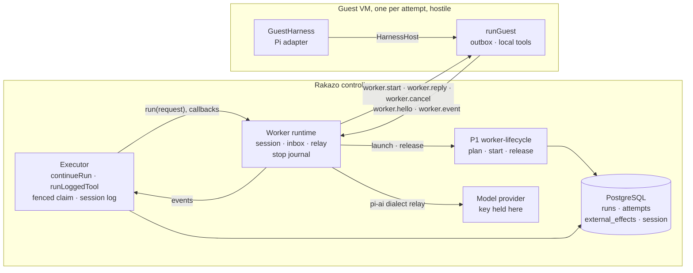
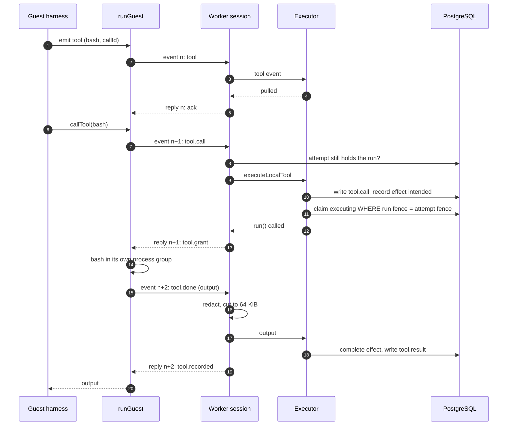
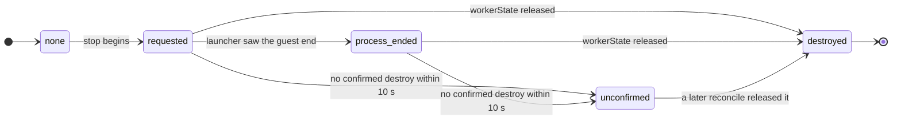

# P2 worker channel, journal and stop handoff

**Verdict. A run's agent can now run in a hostile guest while the controller keeps authorization, keys, the session log and the stop decision. The ten protocol lanes pass offline on the local runner. No product run uses a guest yet.** No composition root builds the worker runtime until P3 composes a provider. The only schema change is two nullable columns on `attempts`.

## Integrated references

- Feature base: `feature/pi-e2b-workers` at `10dddc2c1`. It contains P0 and P1 ([#220](https://github.com/RomainJeff/rakazo-bot/pull/220)).
- P1 handoff: [P1-handoff.md](P1-handoff.md). P2 consumes its messages, the worker lifecycle and `attempts.workerState` unchanged, and adds the run input to `worker.start`.
- Infrastructure documentation reference: `09f242991ada8fdab2a9ce7a1fa847671d511874`.
- SDK: pi-agent-core, pi-ai and pi-telemetry 1.3.0, unchanged from P0.
- Slice branch: `codex/pi-e2b-p2-transport`. The tested commit is recorded in the [verification receipt](evidence/P2/verification.json).

## What P2 adds

| Layer | File | Content |
| --- | --- | --- |
| Wire | `packages/adapter-kit/src/worker-protocol.ts` | `worker.hello`, `worker.reply`, the typed `worker.event` payload, `GuestBody`, `ReplyPart`, `ReplyFinal`, `RefusalReason`, `GuestRunInput`, `ModelDialect`, `HarnessDeclaration`, `FRAME_CAPABILITY`, `sameWorker`. |
| Runtime contract | `packages/adapter-kit/src/types.ts` | `AgentRunRequest.executeLocalTool` and `attempt`, `AgentRuntimeCapabilities.localTools`, `AgentRuntimeUnavailableError`. |
| Policy | `packages/core/src/effect-phase.ts`, `worker-stop.ts` | `effectPhase(status)`, `STOP_PHASES`, `stopState(attempt)`. Pure. |
| Database | `packages/db/prisma/migrations/20261019130000_attempts_stop_phase` | `attempts.stopPhase`, `attempts.stopPhaseAt` and their check. |
| Controller | `packages/adapters/src/runtime-worker/` | `createWorkerAgentRuntime` (an `AgentRuntime`), the session, capability, framing, inbox, event pipe, launcher on the P1 lifecycle, stop journal, limits, and the `pi-ai` dialect relay. |
| Executor | `packages/adapters/src/executor.ts` | The local tool path with a fenced claim, the requeue on `AgentRuntimeUnavailableError`, and the duplicate-key re-read in `recordEffect`. |
| Guest | `apps/agent-run-worker/` | `runGuest`, the outbox, the `bash` tool, the `GuestHarness` interface, the Pi adapter, and the stdio entry point `main.ts`. |
| Test runner | `packages/testkit/src/local-worker-provider.ts`, `worker-run-fixture.ts`, `runtime-worker-bench.ts` | `LocalWorkerProvider` with faults, the real executor on PGlite through a guest, and `pnpm bench:worker-channel`. |
| Lint | `biome.json` | No agent SDK import outside `apps/agent-run-worker/src/harness/` and `packages/adapters/src/runtime-worker/dialects/`. |

## Architecture

The executor is unchanged in shape. It calls an `AgentRuntime`, as before. The worker runtime turns that call into a guest, and every callback the executor used to hand an in-process runtime becomes a frame the controller decides.



The seam is `AgentRuntime`. The guest runs the same `PiAgentRuntime` the controller runs in process, with an injected `streamFn` that sends model calls to the controller and callbacks that become frames.

## Protocol version 1

Every message carries `version: 1` and the `worker` identity `{ runId, attemptId, fence }`. Each direction has its own non-throwing parser. Frames are JSON objects. On a byte stream, each frame has a 4-byte big-endian length prefix (`encodeFrame`, `readFrames`). The reader refuses an oversized frame on its prefix, before it reads the body.

| Kind | Direction | Content |
| --- | --- | --- |
| `worker.hello` | Guest to controller, first on each connection | The capability and the harness declaration. Unnumbered. |
| `worker.start` | Controller to guest | P1's identity, workspace and computer mode, plus `run`, the callback-free run input. |
| `worker.event` | Guest to controller | `payload: { seq, body }`. `body` is a `GuestBody`. |
| `worker.reply` | Controller to guest | `payload: { re, part, body }`. One or more parts answer the event `re`. The last is a `ReplyFinal`. |
| `worker.cancel` | Controller to guest | Identity only. The controller destroys the VM whatever the guest does. |

The guest sends two kinds of body. Informative bodies are `text`, `progress`, `tool` and `subagent`, and their reply is a flow-control `ack`. Every other body asks the controller to decide or to persist, and its reply is that decision.

| Guest body | Final reply | Controller action before the reply |
| --- | --- | --- |
| `text`, `progress`, `tool`, `subagent` | `ack` | Checks a `tool` name against the run's tools, redacts text, and hands the event to the executor. Replies once the executor pulled it. |
| `model.request` | `model.event` parts, then `model.end` | Runs the call with its own model and key, streams the events, records usage. |
| `model.abort` | `ack` | Aborts the upstream call of the request `re`. |
| `tool.call` | `tool.result`, or `tool.grant` for a guest tool | Checks the fence, the name and the announcement. Runs a controller tool, or journals and claims a guest tool. |
| `tool.done` | `tool.recorded` | Redacts and cuts the output, completes the effect, writes `tool.result`. |
| `steering.claim` | `steering` | Claims steering under the fence. |
| `subagent.open`, `.text`, `.finish`, `.abandon` | `subagent.opened`, `recorded` | Opens and logs a helper. |
| `ask`, `takeover` | `recorded` | Pauses the run through the executor. |
| `done` | `end.refused` part if calls are open, then `stop` | Holds the end until every open call settles. |
| `failed` | `stop` | Fails the attempt. |

A `refused` final reply carries a `RefusalReason`: `invalid`, `version`, `capability`, `identity`, `sequence`, `window`, `too_large`, `unknown_tool`, `revoked`, `budget` or `undeclared`. A refused request ends the channel and the attempt.

### Examples

These frames come from a run on the local runner. Only the identifiers were shortened, and long strings are cut where marked.

The guest says hello:

```json
{"version":1,"kind":"worker.hello","worker":{"runId":"run_1","attemptId":"attempt_1","fence":1},"capability":"rkw1.<claims>.<mac>","harness":{"name":"pi","capabilities":["subagents","steering"]}}
```

The controller starts the run. `where` places each tool. The real frame lists 42 tools, of which only `bash` runs in the guest:

```json
{"version":1,"kind":"worker.start","worker":{"runId":"run_1","attemptId":"attempt_1","fence":1},"workspace":{"cwd":"/workspace","mounts":[]},"computer":"none","run":{"botId":"bot_1","threadId":"thread_1","sourceMessageId":"message_1","prompt":"Current date and time: … Say hi.","instructions":"…","history":[],"images":[],"tools":[{"name":"message_user","description":"…","inputSchema":{"…":"…"},"where":"controller"},{"name":"bash","description":"…","inputSchema":{"…":"…"},"where":"guest"}],"model":{"provider":"openai-compatible","id":"offline-fixture","acceptsImages":false,"thinkingLevel":null},"allowSilentEmpty":true,"freeTextIsPrivate":true,"runRecap":true}}
```

A model call and its streamed reply:

```json
{"version":1,"kind":"worker.event","worker":{"runId":"run_1","attemptId":"attempt_1","fence":1},"payload":{"seq":2,"body":{"type":"model.request","agent":"root","dialect":"pi-ai","call":{"context":{"messages":[{"role":"system","content":"…"},{"role":"user","content":"…"}]},"options":{"sessionId":"thread_1:bot_1"}}}}}
{"version":1,"kind":"worker.reply","worker":{"runId":"run_1","attemptId":"attempt_1","fence":1},"payload":{"re":2,"part":4,"body":{"type":"model.event","event":{"type":"toolcall_end","contentIndex":0,"toolCall":{"type":"toolCall","id":"sh","name":"bash","arguments":{"command":"echo hi"}}}}}}
{"version":1,"kind":"worker.reply","worker":{"runId":"run_1","attemptId":"attempt_1","fence":1},"payload":{"re":2,"part":6,"body":{"type":"model.end"}}}
```

A guest tool, from announcement to recorded result:

```json
{"version":1,"kind":"worker.event","worker":{"runId":"run_1","attemptId":"attempt_1","fence":1},"payload":{"seq":4,"body":{"type":"tool","name":"bash","args":{"command":"echo hi"},"executionId":"sh"}}}
{"version":1,"kind":"worker.event","worker":{"runId":"run_1","attemptId":"attempt_1","fence":1},"payload":{"seq":5,"body":{"type":"tool.call","agent":"root","callId":"sh","name":"bash","args":{"command":"echo hi"}}}}
{"version":1,"kind":"worker.reply","worker":{"runId":"run_1","attemptId":"attempt_1","fence":1},"payload":{"re":4,"part":0,"body":{"type":"ack"}}}
{"version":1,"kind":"worker.reply","worker":{"runId":"run_1","attemptId":"attempt_1","fence":1},"payload":{"re":5,"part":0,"body":{"type":"tool.grant"}}}
{"version":1,"kind":"worker.event","worker":{"runId":"run_1","attemptId":"attempt_1","fence":1},"payload":{"seq":6,"body":{"type":"tool.done","callId":"sh","output":{"text":"hi","isError":false,"truncated":false,"totalBytes":3}}}}
{"version":1,"kind":"worker.reply","worker":{"runId":"run_1","attemptId":"attempt_1","fence":1},"payload":{"re":6,"part":0,"body":{"type":"tool.recorded"}}}
```

A controller tool answers the call directly:

```json
{"version":1,"kind":"worker.reply","worker":{"runId":"run_1","attemptId":"attempt_1","fence":1},"payload":{"re":11,"part":0,"body":{"type":"tool.result","output":{"ok":true}}}}
```

The end, accepted:

```json
{"version":1,"kind":"worker.event","worker":{"runId":"run_1","attemptId":"attempt_1","fence":1},"payload":{"seq":16,"body":{"type":"done","text":"…","privateFinalText":"…"}}}
{"version":1,"kind":"worker.reply","worker":{"runId":"run_1","attemptId":"attempt_1","fence":1},"payload":{"re":16,"part":0,"body":{"type":"stop","reason":"done"}}}
```

An end held while a call is open, then a refusal, from the hostile tests:

```json
{"re":3,"part":0,"body":{"type":"end.refused","pending":["c1"]}}
{"re":1,"part":0,"body":{"type":"refused","reason":"unknown_tool"}}
```

## Capability and expiry

The capability is `rkw1.<claims>.<mac>`. `claims` is base64url JSON `{ runId, attemptId, fence, expiresAt }`, and `mac` is HMAC-SHA256 over it. The key is 32 random bytes held in the memory of one worker runtime instance. A controller restart therefore revokes every capability, as it already ends every attempt.

The controller checks a hello in this order, before any database read: frame size, JSON and schema, MAC in constant time, expiry, then identity equal to the attempt this session launched. A capability lives `capabilityTtlMs` (10 minutes) to cover a cold boot, and is checked only at hello. After hello, the connection is bound, and every frame's `worker` must equal the session's identity.

A capability binds one connection at a time. A second hello while one is bound is closed without a reply. After that connection ends, the same capability may reconnect, until the stop begins. The guest reads it from `RAKAZO_WORKER_CAPABILITY` and deletes it from its environment, so commands it starts do not inherit it.

## Sequences and acknowledgement

The guest numbers its events from 1 for the whole attempt. A frame stays in the guest's outbox until its final reply, counted against a window of `inflightFrames` frames and `inflightBytes` bytes. A producer waits while the window is full, so the harness stalls instead of buffering. After a reconnect, the guest resends every frame still waiting, with the same numbers.

The controller accepts only `seq` equal to the last one plus one. It decides each number once. It keeps the parts of the last `replyCache` settled replies and answers a resend from them. A resend whose reply left the cache, a gap, or a frame beyond the window is refused, and the channel ends.

The controller sends a reply only after the durable write it stands for:

- `ack` to an informative frame goes out once the executor pulled the event. The executor's loop is the channel's backpressure.
- `tool.grant` goes out after the executor wrote `tool.call` and claimed the effect `executing` under the fence.
- `tool.recorded` goes out after the effect completed and `tool.result` was written.
- `recorded` to `ask` and `takeover` goes out after the executor handled the pause.

Deduplication by `(attempt, seq)` lives in memory and dies with the attempt. Durable deduplication uses three things the executor already has. They are the effect idempotency key, the replay of an unanswered call with the same input, and the steering claim.

### A guest-local tool



If the approval policy holds the call, the executor pauses the run without calling `run()`. The guest then gets `tool.result` with the paused result instead of a grant, and the command never starts.

## Effect states

`effectPhase(status)` in `packages/core/src/effect-phase.ts` maps `external_effects.status` to what a resumed run may do.

| Status | Phase | Meaning for P5 |
| --- | --- | --- |
| `intended`, `approved` | `not_started` | Nothing ran. It may run under a new claim. |
| `executing` | `started` | It may have run. The next claim marks it `uncertain`. |
| `completed` | `completed` | Its result is stored. Return it. |
| `uncertain` | `uncertain` | Never run it again. The model is told the outcome is unknown. |
| `denied` | `denied` | Return the refusal. |

An unknown status reads as `uncertain`. Bash is never replayed blindly. A guest effect whose result did not reach the controller stays `executing`, then `uncertain`.

## Limits

`WORKER_LIMITS` in `packages/adapters/src/runtime-worker/limits.ts` is the only source of these values. The controller enforces each one, because the guest is hostile.

| Limit | Value | Enforced by |
| --- | --- | --- |
| `guestFrameBytes` | 1 MiB | Controller, after parse, for every guest body but `model.request` |
| `modelRequestBytes` | 8 MiB | Controller, on the length prefix of every guest frame |
| `controllerFrameBytes` | 8 MiB | Guest, on the length prefix |
| `inflightFrames` | 32 | Guest outbox, and the controller refuses beyond it |
| `inflightBytes` | 4 MiB | Guest outbox. A lone larger frame still goes. |
| `replyCache` | 64 settled replies | Controller inbox |
| `textFlushBytes`, `textFlushMs` | 4 KiB, 50 ms | Guest text coalescing |
| `toolArgsBytes` | 256 KiB | Controller, on `tool` and `tool.call` |
| `localOutputModelChars`, `localOutputModelLines` | 12,000 characters, 2,000 lines | Guest bash: head and tail for the model, with the spool path |
| `localOutputSpoolBytes` | 16 MiB per command | Guest disk. Capture stops past it, and `totalBytes` still counts everything. |
| `controllerResultBytes` | 64 KiB | Controller, on every guest tool result before it is recorded |
| `capabilityTtlMs` | 10 minutes | Controller, at hello |
| `helloDeadlineMs` | 30 s | Controller. A guest that never says hello makes the attempt unavailable. |
| `cancelGraceMs` | 2 s | Controller, between `worker.cancel` and destroy |
| `stopConfirmMs` | 10 s | Controller, from the stop to `unconfirmed` |
| `modelRequestsPerAttempt` | 400 | Controller. Beyond it the request is refused with `budget`. |

## Crash and retry matrix

| What fails | What the controller sees | Durable outcome | Next step |
| --- | --- | --- | --- |
| A guest frame is lost before it reaches the controller | The connection ends before the run did | Nothing written for that frame. No effect starts. | The attempt fails as unavailable, the run is requeued, and a new attempt starts a new guest (lane 5). |
| A controller reply is lost, and the guest reconnects | The same `seq` again | The decision was made once | The inbox answers from its cache. Nothing runs twice (lane 2). |
| The channel ends after a guest effect started, before `tool.done` | The connection ends with the grant open | The effect stays `executing` | The run is requeued. The next claim marks it `uncertain`, and bash is not rerun (lane 6). |
| The attempt loses its run to a newer claim | The session's fence check fails on `tool.call` | The database refuses the claim | The guest gets `revoked`, the session stops it, and no effect starts (lane 3). |
| The controller process restarts | Nothing: the session, its key and its reply cache are gone | Runs, attempts, effects and the log are durable | The run lease expires within 5 minutes. A new claim makes a new attempt. Its launch is refused while the old worker is not confirmed gone, and the run requeues until P1's `reconcile` releases it. The old guest cannot reconnect, because its capability fails the new key. |
| The controller restarts while the run waits for an approval | The pause already ended the attempt and released its VM | The approval card and the effect `intended` | A continue before the answer only asks again. The tool runs once, after the stored answer (lane 9). |
| The guest breaks the protocol | A refused frame | Nothing for that frame | The runtime throws `WorkerViolationError`. The executor requeues only on `AgentRuntimeUnavailableError`, so it treats this as a run error. That reading of the executor is not tested end to end. |
| The guest ends while a call is open | `done` with open calls | Nothing closes early | `end.refused`, then `stop` once the calls settle (lane 10). |
| The guest never says hello | No hello within 30 s | Nothing | The attempt is unavailable, and the run requeues. |
| A model call fails at the provider | An error from the relay | Usage, when the provider reported it | Only that call fails. The guest gets the error event. |
| A guest sends a malformed transcript | A provider or parse error on that call | Nothing | Only that call fails. |

## Abort contract and reconciliation

The executor stops a guest the way it stops any runtime. It calls `runtime.abort(runId)` or aborts the run's signal. The session then takes these steps:

1. Refuses every new frame as `revoked` and aborts every model relay.
2. Records `stopPhase = requested`.
3. Sends `worker.cancel` if a connection is bound.
4. Waits for the guest process to end, at most `cancelGraceMs`.
5. Calls the P1 lifecycle `release`, which destroys the VM.
6. Waits for a confirmed `released`, at most `stopConfirmMs` minus the grace.
7. Records `unconfirmed` if the destroy was not confirmed in time.

Whenever the launcher sees the guest process end, the session records `process_ended`. On a confirmed destroy, the stop waits for that record before it returns.

`process_ended` comes from the launcher only, never from a guest's word. Pending guest results are rejected once the executor saw its own signal abort, so the executor never records a result after it stopped.

`stopState(attempt)` in `packages/core/src/worker-stop.ts` derives the full view. The VM is destroyed exactly when the P1 lifecycle released the worker. `attempts.stopPhase` has one writer, the stop journal, and a phase never moves back.



No second guest of a run starts while an earlier worker of that run is live or `releasing`. The launcher refuses with `AgentRuntimeUnavailableError`, and the executor requeues the run with its usual backoff. A stop is never reported as destroyed unless the provider confirmed it.

## Harness interface and model dialect

The run channel names no harness. The guest runs a `GuestHarness`, which is a declaration and a `run(start, host)` function. The declaration gives the harness name and its optional capabilities, `subagents` and `steering`. The `HarnessHost` gives it `emit`, `decide`, `model` and `callTool`, and a cancel signal. Pi is the only adapter, in `apps/agent-run-worker/src/harness/pi.ts`, selected by `RAKAZO_WORKER_HARNESS` (default `pi`). The generic guest code imports no agent SDK, and a lint rule enforces it.

Model access is a named dialect, separate from the run channel. `pi-ai` is the only one. The controller keeps the request caps, `model.abort` and usage accounting outside the dialect, so a second dialect reuses them.

[How to add a harness](adding-a-harness.md) gives the interface, the guarantees, the template changes and the conformance tests.

## Test runner and receipts

`LocalWorkerProvider` in `packages/testkit/src/local-worker-provider.ts` implements P1's `WorkerProvider` and P2's `GuestConnector`. A VM is a directory. In `memory` mode the guest runs `runGuest` in the test process over an in-memory channel. In `child` mode it runs `apps/agent-run-worker/src/main.ts` as a detached child over stdio, and `destroy` sends `SIGTERM` to its process group, then `SIGKILL` after 2 s.

| Fault | Mode | Effect |
| --- | --- | --- |
| `cutBeforeGuestFrame`, `cutAfterGuestFrame` | memory | Sever the connection around a guest frame |
| `dropControllerFrame`, `cutBeforeControllerFrame` | memory | Lose a reply, or sever before it |
| `holdGuestFrame` | memory | Deliver a guest frame only when a promise settles |
| `reconnects` | memory | Let the guest open that many more connections |
| `guestIgnoresCancel` | both | `worker.cancel` never reaches the guest |
| `destroyNeverConfirms` | both | `destroy` never answers |

`startWorkerRun` in `packages/testkit/src/worker-run-fixture.ts` runs the real executor on PGlite with a guest and the model emulator. `restart()` builds a new controller on the same database.

The receipts are in `evidence/P2/`: [verification.json](evidence/P2/verification.json), [lanes.json](evidence/P2/lanes.json), [bench.json](evidence/P2/bench.json), [reproduce.txt](evidence/P2/reproduce.txt) and the [lane capture](evidence/P2/media/lanes-cli.png).

## Verification

At the tested commit, the workspace typecheck passes 24 tasks. Lint passes with the base's 47 warnings and 1 info. The root unit suite passes 7,992 tests. The 78 P2 tests pass in 11 files. The PostgreSQL harness passes all 23 suites with the new migration applied.

| Lane | Proof | Result |
| --- | --- | --- |
| 1 | Text, a guest tool, a controller tool and the recap run through the local runner and log once. The guest never holds the model key. | Pass |
| 2 | A request resent after a lost reply is answered from the first decision. One write. | Pass |
| 3 | A guest tool under a replaced fence is refused, the database refuses its claim, and no second guest starts. | Pass |
| 4 | A capability of another run is refused before any callback runs. A bound capability cannot be reused. | Pass |
| 5 | A cut before the tool call reaches the controller starts no effect. The retry runs it once. | Pass |
| 6 | A cut after the effect, before its result, leaves it `uncertain`. Bash does not run again. | Pass |
| 7 | A 5 MiB output stays within 12,000 characters for the model, under 1 MiB on the wire and whole on the guest disk. The controller cuts and redacts what a hostile guest sends. | Pass |
| 8 | A child guest that ignores its cancel is destroyed within the budget. A destroy that never answers is recorded `unconfirmed`, and the next attempt starts no guest. | Pass |
| 9 | After a controller restart during an approval, nothing runs before the stored answer. | Pass |
| 10 | A guest `done` while a call is open is held until the call settles. | Pass |

This phase also adds a test that a guest's `model.abort` closes the controller's upstream call. It fails when the session ignores the abort. A last test makes the stop journal fail after an unconfirmed stop and proves the controller survives it: without the handler, the late write was an unhandled rejection.

## Performance

`pnpm bench:worker-channel` measures the added control per guest tool. That is the time from reading `tool.call` to sending `tool.grant`, plus the time from reading `tool.done` to sending `tool.recorded`, at the controller's side of the channel. It runs 30 trials after 3 warm-up trials, 5 bash calls per run, rotating three arms. The in-process arm runs the same journaling through `executeLocalTool` with no channel and no model. Trunk has no guest tool, so the bench reports absolute cost, not a ratio.

| Arm | First tool of an attempt, p50 and p95 | Later tools, p50 and p95 | Queries per tool |
| --- | --- | --- | --- |
| In process, no channel | 4.1 ms, 5.0 ms | 3.4 ms, 4.0 ms | 15, then 13 |
| Guest in memory | 6.5 ms, 9.2 ms | 6.0 ms, 8.6 ms | 20, then 17 |
| Guest in a child process | 7.0 ms, 10.6 ms | 6.2 ms, 10.2 ms | 19, then 17 |

The worst p95 is 10.6 ms against the proposed 200 ms budget. Database queries take 80 to 96 percent of the control time, so the query count bounds it. The guest arms run 4 more queries per tool than the in-process arm, measured by query name. One is the session's fence check before each call. The other three are the executor's handling of the `tool` announcement, which the in-process arm pays before its window opens. The first tool of a run adds one-time reads of the approval rules and the auto-review preference, plus one query in memory mode that the bench did not attribute. A first full run earlier the same day gave later-tool p95 of 6.8 ms in memory and 9.7 ms in a child process. The difference between runs is within the spread of either.

These numbers come from PGlite in memory, at about 0.3 ms per query. On a production database each query costs a network round trip, and a remote guest adds two channel round trips per tool. With 17 queries at 1 ms each, the control would be near 20 ms plus the two round trips. That is an inference, not a measurement. P3 measures it on E2B.

Guest boot, from connect to hello, takes 0.07 ms in memory and 1.22 s at p50 in a child process, which spawns Node with tsx and loads Pi. A VM boot is not measured.

| Stop case, cancel to destroyed | p50 | Max |
| --- | --- | --- |
| Guest in memory honors its cancel | 4.4 ms | 7.7 ms |
| Child guest honors its cancel | 17.2 ms | 26.6 ms |
| Guest in memory ignores its cancel | 2.01 s | 2.01 s |
| Child guest ignores its cancel | 2.03 s | 2.04 s |

All 120 stops were recorded as process ended and released, against the 10 s budget. A guest that ignores its cancel costs the 2 s `cancelGraceMs` wait, then the destroy. The child guests here still honor `SIGTERM`. A guest that also ignores `SIGTERM` adds the provider's 2 s kill grace, which bounds it near 4 s. That bound is read from the constants, not measured in the bench.

## Entry conditions for successors

- **P3** composes an E2B worker provider that also implements `GuestConnector`. The connector must deliver whole frames in order in each direction, make each reconnect a new channel, and settle `exited` only from the provider's own observation. P3 picks the transport. P3 composes `createWorkerAgentRuntime` with `createLifecycleLauncher` in `apps/api/src/app.ts` and `apps/worker/src/index.ts` when a provider is configured. It keeps an in-process runtime for the auto-review judge and the skill nudge, which still call `deps.runtime`, and for scripted runs, which the worker runtime refuses. It derives `RunNeeds` from tool routing, because the launcher passes no files and no computer today. It wires `reconcile` into the job reconciler, so an `unconfirmed` stop is eventually released. It builds the worker image from `apps/agent-run-worker/src/main.ts` with `RAKAZO_WORKER_CAPABILITY`, `RAKAZO_WORKER_HARNESS`, `RAKAZO_WORKER_ROOT` and `RAKAZO_WORKER_SPOOL_DIR`. The guest needs no network route except to the controller. It adds read, write, edit and grep to `GUEST_TOOLS` and `LOCAL_TOOLS` behind the same grant. It confirms `capabilityTtlMs` and `helloDeadlineMs` against E2B cold boots, and measures the control cost on PostgreSQL across the E2B network.
- **P5** rebuilds a run without the worker disk. It reads `effectPhase` and never reruns an `uncertain` effect. It treats `executing` as `uncertain` on the next claim. It reads `stopState` and starts no writer before `destroyed`. The channel's in-memory deduplication dies with the attempt. The durable keys are the effect idempotency key, the replay of an unanswered call and the steering claim.

## Limits

- The guest is hostile, including its Pi process, which bash can modify. The grant wrapper proves only that a conforming guest asked before it ran a tool. A malicious guest can bypass its own wrapper and write to its mounts without asking. Worker frames are not a tamper-proof audit of local effects.
- No E2B VM, volume or credential was used. The lanes run on the local runner, PGlite and the PostgreSQL harness.
- `recordEffect` re-reads the row after a duplicate-key error, for two attempts that record the same call at once. No test covers it. A deterministic test needs a Prisma hook that inserts the competing row between the read and the create, a seam no production caller needs. Without the re-read, the loser's tool call fails with an error. The unique key already prevents a second effect.
- A helper's guest tool goes through `SubagentLog.executeLocalTool`. No test runs a helper that calls a guest tool.
- A controller tool's output reaches the guest as JSON. Binary output, such as a screenshot, does not survive the trip. P4 decides how computer tools return images.
- In child mode, a guest that ignores `SIGTERM` leaves its commands running after `SIGKILL`, because they run in their own process groups. Destroying a real VM ends them.
- The relay passes the guest's transcript to the provider without full validation. A malformed transcript fails only that call.
- `model.request` accepts only the `pi-ai` call schema. A second dialect turns it into a union, as the harness guide describes.
- `LocalWorkerProvider` always runs the Pi harness.
- PGlite's socket server keeps a connection's messages together only inside a transaction. Outside one, concurrent connections can interleave their parse and bind messages on PGlite's single session. A draft of the bench hit this as a parameter type error on the stop journal update, so PGlite tests with concurrent queries can fail for reasons PostgreSQL does not share. That PostgreSQL is unaffected is an inference from the socket server's queue code.
- The web E2E selector ran the full suite, because no impact map exists. It reports 211 passed and 11 failed, the same counts as the feature base. No web or UI source changed.
- There is no user interface change, so there are no captures beyond the lane capture.

## Rollback

The migration is additive. To roll back before P3 composes the worker runtime, revert the slice and drop `attempts_stop_phase_check`, `attempts.stopPhase` and `attempts.stopPhaseAt`. No composition root builds the worker runtime, so no row holds a stop phase and nothing needs draining.
