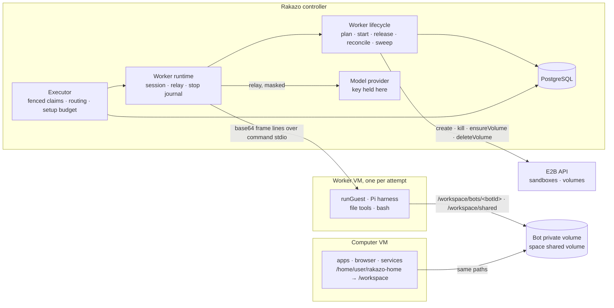

# P3 native Pi in the worker and file migration handoff

**Verdict: P3 passes live on the final feature code.** All sixteen lanes passed on the shared E2B host against commit `e14aae9aa7e95caf0338faf129354aa6a7fdfc00`, which is the feature branch at `d475675e3` with S6 ([#257](https://github.com/RomainJeff/rakazo-bot/pull/257)), S7 ([#254](https://github.com/RomainJeff/rakazo-bot/pull/254)) and S8 ([#261](https://github.com/RomainJeff/rakazo-bot/pull/261)) plus this pass's first two harness commits. The bench ran at `935a765d1`, whose only further change is the bench's own local arm; the product code and the guest bundle are identical. The worker template was rebuilt from `e14aae9`. Each lane ended with no sandbox and no volume of its session. The bench measured the direct per-call proxy overhead and the controller's RSS on PostgreSQL; both are in [Performance](#performance). The earlier receipts at `b5c0a4609` are superseded.

## Integrated references

- Feature base: `feature/pi-e2b-workers` at `d475675e3`. It contains P0, P1, P2, the multi-writer shared volume ([#224](https://github.com/RomainJeff/rakazo-bot/pull/224)) and every P3 slice: guest file tools ([#228](https://github.com/RomainJeff/rakazo-bot/pull/228)), the E2B provider, codec, bundle and template ([#229](https://github.com/RomainJeff/rakazo-bot/pull/229)), the home move ([#241](https://github.com/RomainJeff/rakazo-bot/pull/241)), the composition ([#243](https://github.com/RomainJeff/rakazo-bot/pull/243)), the first live pass ([#245](https://github.com/RomainJeff/rakazo-bot/pull/245)), S7 native tools ([#254](https://github.com/RomainJeff/rakazo-bot/pull/254)), S6 computerless runs and the home-move fence ([#257](https://github.com/RomainJeff/rakazo-bot/pull/257)) and S8 skills on volumes ([#261](https://github.com/RomainJeff/rakazo-bot/pull/261)).
- This pass: branch `claude/pi-e2b-p3-live-final`. The tested commit and the receipts are in the [verification receipt](evidence/P3/verification.json).
- Predecessor handoffs: [P0](P0-handoff.md), [P1](P1-handoff.md), [P2](P2-handoff.md). Infrastructure: I1, delivered in the infrastructure repository's pull request #2 (merge `177c1ff`), with its receipts at `9c1b44e` (functional) and `a38c067` (isolation). Its main branch was at `e17503b` during the runs.
- SDKs: pi-agent-core, pi-ai, pi-telemetry and pi-coding-agent 1.3.0, unchanged. The E2B SDK is `e2b@2.49.1` in the application. The E2B platform build is the one the I1 handoff records. This slice did not read it again.
- Templates: the experimental worker template `p3live-worker-pi`, built from `apps/agent-run-worker/template` at the tested commit and deleted after the pass, and I1's `i1-computer` for the computer VMs.

## What P3 adds, by layer

| Layer | Slice | Files | Content |
| --- | --- | --- | --- |
| Guest tools | #228, replaced by S7 | `apps/agent-run-worker/src/harness/pi-tools.ts`, `tool-output.ts`, `runtime-worker/pi-tools.json` | Pi coding-agent 1.3.0 supplies native `read`, `write`, `edit`, `bash`, `grep`, `find` and `ls`. P2 still grants and records each local effect. The in-process tools keep their existing contracts. |
| Provider | #229, #243, S5 | `packages/adapters/src/e2b-worker.ts` | `E2BWorkerProvider` implements `WorkerProvider` and `GuestConnector`. One `secure` sandbox per attempt, tagged `{ rakazo: "worker", attemptId }`, volumes mounted by name, created and deleted by name. The sandbox timeout is the worker TTL, `WORKER_TTL_SECONDS`, one hour. Where a deployment allows less (`maxTimeoutMs`), the provider caps it and logs a warning. |
| Codec | #229 | `packages/adapters/src/runtime-worker/framing.ts` | `encodeFrameLine` and `readFrameLines`: one base64 line per frame on stdio, replacing P2's 4-byte length prefix. E2B delivers command output through a text decoder, and base64 survives it. |
| Template | #229, S5 | `apps/agent-run-worker/template/template.ts`, `build.ts`, `scripts/bundle.ts` | Node 24 base with bash, git, procps and CA certificates, and the guest bundle at `/opt/rakazo/agent-run-worker.mjs`. The Pi layer installs ripgrep and fd-find, with an fd symlink for Debian. Root steps run as root, and `/workspace` belongs to the sandbox user. `WORKER_PROFILE` is 1 vCPU and 1024 MiB. |
| Home move | #241, S5 | `packages/adapters/src/home-volume-migration.ts`, `e2b-volume-files.ts`, `scripts/migrate-home-to-volumes.ts` | `moveHomeToVolumes`: plan, copy, verify by hash and mode, adopt. `E2BVolumeFiles` reaches each volume through a sandbox that mounts it. It stages each file 0600 beside its target and renames it over the target, and it replaces a sandbox only once the control plane no longer lists it. |
| Lifecycle | #241, #243 | `packages/adapters/src/worker-lifecycle.ts`, `packages/db/src/volumes.ts` | `ensureVolume` with an `ensureUntil` deadline, `provisionAttachedBotVolume`, `inspectHomeMove`, `adoptVolumeHome`, owner deletion with volume tombstones, and `sweepVolumes`. |
| Composition | #243 | `packages/adapters/src/worker-composition.ts`, `executor.ts`, `e2b-sandbox.ts`, `runtime-worker/session.ts`, `apps/api/src/app.ts`, `apps/worker/src/index.ts` | `composeWorkers` in both roots. The executor routes a run by `deriveRunNeeds` and owns the setup retry budget. The reconciler releases lost workers and sweeps deleted volumes. The E2B computer mounts the volumes and links its workspace to their root. The relay masks the transcript and runs every call with the controller's model, key and session. |
| Live lanes | S5, S6, S8, final pass | `packages/testkit/src/worker-live/`, `cli/worker-live.ts`, `cli/bundle-worker-live.ts` | `pnpm test:worker-live` and `pnpm test:worker-live:bundle`. Sixteen lanes and the bench. |

## Architecture



The worker and the computer are separate VMs with separate kernels. They share files only through the volumes, which E2B serves over NFS from the orchestrator, at the same paths in both VMs. The controller, the session log, the database and every key stay outside both VMs.

## Run a worker

1. Build the worker template under the name the deployment will use: `pnpm --filter @rakazo/agent-run-worker template:build --name rakazo-worker-pi`. The build uploads the template's files to a port that a self-hosted deployment may expose on its own host only. In that case, build on that host.
2. Set `WORKER_PROVIDER=e2b` with E2B's standard environment: `E2B_API_KEY`, and `E2B_API_URL` with `E2B_SANDBOX_URL`, or `E2B_DOMAIN`. Set `WORKER_TEMPLATE` only for another template name. Both the API and the job worker read them.
3. Move each computer's home onto volumes, as in [Home move, retention and rollback](#home-move-retention-and-rollback). A bot whose home is still a snapshot keeps running in process.

To check a deployment, run the lanes: `pnpm test:worker-live lanes --template <worker template> --computer-template <computer template> --out <dir>`, with `--lanes a,b` to pick lanes, and the bench: `pnpm test:worker-live bench --template <worker template> --computer-template <computer template> --out <dir> --trials 30`.

For a host with no checkout, `pnpm test:worker-live:bundle` writes `packages/testkit/dist/worker-live/`: the lanes as one ES module for Node 22, PGlite's assets, the migrations, the guest bundle, the hand-written guest of lane e-refusals, and the two modules the E2B SDK imports to upload template files. Copy that directory, then run `node live/bin/worker-live.mjs template --guest live/guest/agent-run-worker.mjs --name <template>` and the commands above with `node --expose-gc live/bin/worker-live.mjs` in place of `pnpm test:worker-live`. The exact sequence is in [reproduce.txt](evidence/P3/reproduce.txt).

The guest starts as `node /opt/rakazo/agent-run-worker.mjs`. `RAKAZO_WORKER_CAPABILITY` is on the command only, and the guest deletes it from its environment. `RAKAZO_WORKER_HARNESS`, `RAKAZO_WORKER_HOME=/home/user` and `RAKAZO_WORKER_SPOOL_DIR` are on the sandbox. The provider and template both set the worker home; the entry point refuses a missing or relative home. The spool directory is `<private mount>/.rakazo/tool-output` when the run mounts the private volume, and the guest's temporary directory otherwise.

## Tool selection and helpers

The executor routes each run by its tools. `deriveRunNeeds` mounts both the private and shared volumes read-write when the run has a file tool or the computer's `shell`, for both dedicated and team computers. A worker run hides `shell`: the guest's `bash` replaces it. A bot without a computer is offered no computer or file tools. MCP, integration and `message_user` calls can complete in process or in a worker with no mounts. An attached file that needs a computer fails through the fenced finalizer with a clear error. Lane i proved the computerless case live: an MCP tool served by the controller ran once, its result reached the model, and the run completed with no computer, no volume and an empty mount list.

The controller puts every tool of the run in `worker.start` with its place. When `needs.files.private` is set, the Pi adapter offers the SDK's native `read`, `write`, `edit`, `bash`, `grep`, `find` and `ls` at the mounted working directory. Otherwise it offers no native tools, including no `read` or `bash`, and no skills catalog is sent to the model. The controller uses the SDK-free `runtime-worker/pi-tools.json` manifest, generated by `pnpm --filter @rakazo/agent-run-worker tools:manifest`; the bundle build rejects a stale manifest. Worker runs remove `list_files`, `read_file`, `write_file`, `edit_file` and `shell`. The in-process path keeps them.

Rakazo-specific tools, including computer and browser operations, memory, `message_user`, MCP, integrations and routines, stay on the controller. Native calls still announce `tool`, request `tool.call`, wait for `tool.grant`, send `tool.done`, and wait for `tool.recorded`. Fenced effect claims for mutating tools, journal entries and controller-side redaction still apply. Both the parent and helpers inherit the run's tools. Native read-only flags come from the controller manifest, so inspections execute again on retries and do not require webhook side-effect approval.

Read and edit reject files larger than 250 KiB before loading them; use bash for bounded processing of larger files. Native reads keep a whole-line head and continue at the first unseen line within the 12000-character model budget. Truncated bash output keeps the exit or timeout status beside its truncation marker.

Native contracts differ from the old tools. `write` replaces existing files. `edit` takes an `edits` array with `oldText` and `newText`. Paths are ordinary VM paths: relative paths start in the bot's private mount, and shared files are at `/workspace/shared`. There is no custom workspace path resolver or volume-only write guard.

There is no product setting to disable individual native tools. Helpers inherit the run's native tools and controller tools minus `message_user` and `DELEGATION_TOOL_NAMES`. Lane d exercises the product's model capability filter: `computer_act` is absent for a model without vision, for both the parent and helper. A guest requesting an unexposed tool is refused with `unknown_tool` (lane e-refusals).

## S7 decision and session context

The maintainer decision replaces P3's original tool choice:

> "In the worker VM, generic file and shell tools must be the harness's NATIVE tools."

For Pi these are the seven coding-agent tools above. Rakazo stops maintaining their worker implementations. Everything Rakazo-specific remains a controller tool, and the in-process path stays unchanged.

The worker uses pi-coding-agent's native tool factories and an `AgentSession` bound to the `PiAgentRuntime` Agent, relayed through P2 pi-ai. `PiAgentRuntime` reconstructs controller history and retains Rakazo's tool policy, context pruning, approvals, helpers, steering and recaps. The coding-agent session owns its in-memory transcript projection and explicit resources. Model keys and provider connections stay on the controller.

Lanes a, b and f ran the native tools live. Lane a compares the final file content against the in-process baseline, since native names, overwrite behavior and result formats differ. Pi's `write`, `edit`, `read` and `ls` produced `alpha\ngamma\n` on the volume, the same file as in process.

## S8 skills on volumes

The recorded maintainer decision is:

> "All three converge into ONE harness-neutral folder in the VM user's home: `~/.agents/skills/`. It holds one symlink per skill, rebuilt by the guest runner at run start. Precedence: managed > bot > shared. A name collision is logged and reported to the controller."

Managed skills from `skills/agent/` are baked into the worker template at `/managed-skills/agent`, owned by root with write permissions removed. They are always enabled. Legacy per-bot disable rows are ignored, and user files cannot shadow them. The existing API and UI already prevent managed-skill access changes. Persisted `builtin:` ids and the `builtin` wire source remain for existing clients; the implementation calls these managed skills.

Bot-created skills live at `/workspace/bots/<botId>/skills/`; shared skills live at `/workspace/shared/skills/`. Workers with file volumes mount both folders, including dedicated-computer workers. Location decides their visibility. They have no access switches in the web, Electron or mobile skills lists. The in-process path retains its user-skill store, tools and access behavior, with managed skills always enabled.

The generic guest runner discovers direct skill directories, resolves name collisions, and rebuilds its own links before starting any harness. It receives an explicit VM home. The VM home is fresh for each worker. Convergence requires `~/.agents/skills` to be absent or an empty plain directory and refuses every pre-existing entry, including symlinks. There is no ownership marker or deletion of old entries. Every collision is logged in the guest and persisted as an `agent.skill.collision` event by the controller. Pi loads exactly this folder with `loadSkills({ skillPaths: [skillsDir], includeDefaults: false })`. Its explicit `ResourceLoader` provides only those skills and controller instructions. It reads no ambient AGENTS.md, settings, extensions, prompt templates or themes. The SDK's `formatSkillsForPrompt` builds the catalog, and native `read` loads SKILL.md before native `bash` runs scripts. The controller skill catalog and `skill_read`, `skill_search`, `skill_create`, `skill_update`, `skill_delete` are absent from worker runs. A computerless worker, or a run with file and shell tools disabled, has no native tools. No skills catalog is sent to the model without native `read`; no bot/shared files are mounted.

### SDK adoption

S8 uses pi-coding-agent 1.3.0's `AgentSession`, `SessionManager.inMemory`, explicit `ResourceLoader`, `loadSkills` and `formatSkillsForPrompt`, alongside the native tools. The controller's reconstructed system, user, assistant and tool-result history is replayed into the session manager before prompting. The Agent's existing P2 stream function remains the only model transport, and the session receives exactly the authorized tool implementations through `baseToolsOverride` and an allowlist. The session builds the root system prompt once from raw controller instructions and the explicit skills, while helpers receive the formatted skill catalog and inherit the run's tools. Neither receives a skills catalog without native `read`. Helpers retain Rakazo's runtime policy.

The review attempt confirmed that authentication is not a blocker. `agent-session.js:1653-1654` accepts configured or checked auth. A request-local, in-memory credential store supplies the inert `worker-relay-placeholder` value for the relay provider. No real key, disk credential store, provider HTTP call, ambient resource discovery, session persistence, SDK compaction, SDK retry or cache warming is enabled. `agent-session.js:434-459` replaces request context with the SessionManager projection, which is why replaying only the Agent's state is insufficient. The binding explicitly replays that history into `SessionManager.inMemory` and disposes the session at run end. The offline Pi and worker suites validate behavior through the emulator, including the standalone guest bundle.

### Index, usage and secrets

At normal run end, the guest rediscovers the files, including skills created during that run, and reports their name, description, source, SKILL.md SHA-256, content and supporting text files. Reports travel one skill per frame, followed by a complete-source marker. The fenced controller validates the SKILL.md metadata/hash and scans every reported text file against the run and deployment secrets with its existing secret scanner, and checks shared names and descriptions against every bot's credentials in the space before updating `volume_skills`. Shared observations store only metadata and the content hash, with an empty content field. Supporting files are never stored. The shared viewer shows the description and shared-volume location, so another bot's unknown token in a shared body cannot be copied into the database or returned by the viewer. Managed observations are not stored at all; the managed catalog is read from the baked source. Existing shared content and managed rows are removed by the safety migration. The API lists those observations in the existing skills screen. A new complete shared observation replaces older shared observations in the space, including deleted names. A space-row lock serializes snapshots, and the database compares the controller's end-of-index receipt timestamp against the last applied snapshot, including after an empty snapshot. A later receipt wins even when its attempt started earlier. A delayed callback from an earlier receipt cannot restore stale rows. The controller accepts one complete snapshot per attempt and only sources mounted for that run, plus managed. Skill-use and collision frames each have a limit of 512 per attempt. Bot files remain scoped to their bot. Editable legacy rows remain listed alongside volume observations, even when names match. No legacy row is hidden because there is no persisted proof that a shared observation came from migration. A read of any path ending in `/SKILL.md`, including a converged link, records `agent.skill.used` after the native result has been recorded.

Secret policy: refuse to index a skill when a reported name, path, description, SKILL.md or supporting file contains a known run secret. Log only the bot id and refusal reason. Never persist the offending content, never delete or rewrite its volume files. This is an indexing policy, not a guard against running a script. As before, a hostile guest can lie about its files or reads, so reports are observations rather than a tamper-proof audit.

Discovery accepts legacy SKILL.md files up to 400,000 bytes so the former 100,000-character limit remains readable for Unicode content. The report bounds are 100,000 characters for SKILL.md, 100,000 bytes per supporting text file, 128 supporting files, about 500,000 bytes of text per skill, 512 skills and 8 MiB per complete report. Linked, special, binary or oversized supporting files leave that skill unindexed. Only direct skill directories are discovered. Skills still load from the folder on the next run. An aborted or disconnected worker may not deliver a final index. The controller's private skill-learning nudge stays in process only; it must not write learned skills into the legacy store after a worker run. Native skill writes appear in the list, but do not currently produce the in-process skill-learning footer.

### Migrate existing user skills

Stop the space's writers before running the operator script. Provision the space's shared volume first. On the controller, run:

```sh
pnpm exec tsx scripts/migrate-skills-to-volumes.ts --space <space-id> --dry-run
pnpm exec tsx scripts/migrate-skills-to-volumes.ts --space <space-id>
```

Use `--template <worker-template>` when it differs from the default. The script uses DATABASE_URL, DATA_DIR and the standard E2B environment. Even dry-run reads the volume through a temporary VM; do not run it as an offline test. It copies every owner's legacy `DATA_DIR/skills/user/<spaceId>/<userId>/` bundles into shared `skills/`, verifies their bytes, preserves executable modes and treats identical copies as unchanged. The JSON report lists every skip, identical-bundle merge and conflict. Bundles compare the complete file inventory, bytes and modes, so identical SKILL.md files cannot silently merge different scripts. Non-conflicting bundles proceed; conflicting owner bundles and changed target bundles remain untouched for manual resolution. A retry resumes missing files. Original controller files are never removed, so rollback can keep using them; later edits on volumes are not copied back.

### Computer convergence decision

The computer's existing `/managed-skills` read-only bind is retained. Full home convergence is not enabled on computers in S8. Docker Team Computer commands and coding agents all share `/home/rakazo`; E2B computer commands share `/home/user`. Concurrent bots therefore cannot each rebuild one global home folder with their own private skill precedence. The current Docker startup also lets the owner replace the OpenCode skill path, which S8 must not delete. A coding-agent launch needs a per-bot home/config selection before it can safely consume the same private skill set. Computers continue exposing the managed mount and, on E2B, the volume paths, while their existing coding-agent skill discovery remains unchanged. Worker convergence does not claim to converge a separate computer VM's home.

### Acceptance and live limits

Offline tests run the real guest and Pi relay against the model emulator, both in memory and from the standalone bundle. They cover convergence, precedence, collisions, explicit loading, absence of controller skill tools/catalog, DB/UI indexing, native reads, secret refusal, idempotent migration and managed-skill enablement. The convergence regression also protects pre-existing directories and later user symlinks. The `skills` lane passed live on the rebuilt template. A computer VM seeded a bot skill with a script and a shared skill on the volumes. The first run's Pi catalog listed the managed `Interrogate` skill, `bot-live` and `shared-live`, with no `skill_read` tool. Native `read` loaded the bot skill, native `bash` ran its script and printed its marker, and native `write` created `created-live`. The controller recorded one `agent.skill.used` event and indexed `created-live` as a bot skill. The second run's catalog listed `created-live`. The feature's single changelog entry belongs to its last slice.

## Model relay and capabilities

The guest never holds a model key, an endpoint or a connection. Every model call is a `model.request` frame in the `pi-ai` dialect. The controller masks the run's live secrets in the transcript's text, leaves image data as it is, and runs the call with its own model, key and session id.

- **OpenAI protocol (lane e-openai).** The fixture key was in no guest environment and no guest process's `/proc/<pid>/environ`, while three relayed calls reached the emulator, which checks the controller's bearer key on each call.
- **Anthropic protocol (lane e-anthropic).** A catalog Anthropic model billed with a plain API key, its Messages API emulated on loopback, with a thinking block and a tool call. Three calls relayed with the controller's `x-api-key`, and no guest process held it. Offline, the same run counts the provider's cache reads into the run's input tokens.
- **Refusals (lane e-refusals).** A hand-written guest in the worker VM asked for a model call naming its own model, endpoint and key. The controller ended the run as `The worker broke the run protocol: invalid`, and the upstream got no call. In a second run it called a tool the run does not expose: the controller answered `refused`, ended the run as `unknown_tool`, and released the worker.

The relay reached only the repository's emulator. No real provider was called, and no real key was in the guest.

## Cleanup states

A worker is destroyed only when E2B confirms it, and a writer lease frees only in the transaction that records that. Lane g drove each fault below on real sandboxes, and each run completed.

| What fails | Attempt after the fault | Lease and sandbox | Run | How it ends |
| --- | --- | --- | --- | --- |
| The VM dies right after `ensure` | `released`, ref recorded | Freed, none left | Requeued, then completed on a new VM | Setup fails, release finds the VM gone, and the run is requeued under its setup budget. |
| `ensure` fails after E2B created the VM | `releasing`, no ref | Lease held, VM alive | Requeued, then completed on a new VM | Release cannot tell an in-flight create from none, so it waits for the ensure deadline, 15 minutes. Until then the retry is a busy wait. Reconcile then destroys the VM by its attempt tag and frees the lease. The lane moved the deadline into the past instead of waiting. |
| `prepare` fails after the ref was recorded | `released`, ref recorded | Freed, none left | Requeued, then completed on a new VM | `start` releases its own worker at once, and the run is requeued under its setup budget. |
| The controller dies after `start` | `ready`, ref recorded, recorded before reconcile | Lease held, VM alive | Lease lapses | Reconcile releases it once the run's lease expires: VM destroyed, lease freed. |
| A worker outlives the sandbox timeout | `released` | Freed, none left | Requeued, then completed on a new VM | E2B killed the VM, the stream broke and release found it gone. The next attempt asked for the same `bash` call and got `its outcome is unknown`: the effect became `uncertain` and never ran again. Lane g-timeout gave the sandbox a 20 s timeout, and E2B killed it about 23 s after the run started. |

**Setup budget.** An error from volume creation, `ensure` or `prepare` requeues the run, and the executor counts it against a budget of three setup failures per run, kept in the attempt rows so it survives queue replacement and controller restarts. The third failure fails the run with `Run setup failed after 3 attempts: <reason>`.

- A controller crash before setup completes counts, so three crashes stop the run on its next delivery, before another provider call.
- A busy wait counts nothing: computer or volume contention, or an earlier worker of the run still releasing before its ensure deadline.
- An intentional requeue after a late takeover release counts nothing either.
- Past its deadline, a writer that cannot be released charges the run waiting on it. That covers an earlier worker of the same run, and another run's writer that is releasing, lost its fence or has an expired run lease. A provider that refuses both creation and destruction therefore cannot keep a run queued forever.

P2's stop contract is unchanged: `worker.cancel`, a grace of `cancelGraceMs`, then release, recorded `unconfirmed` when E2B does not confirm within `stopConfirmMs`.

## Home move, retention and rollback

Move one computer's home at a time, with the source computer stopped. A team move also requires no live worker in its space; a dedicated move permits unrelated running computers and workers. S6 reserves the space's existing computers with a durable `home-move:` maintenance marker before planning or copying files. Worker planning and start refuse it as busy, as do computer boots. A computer on volumes added during the copy checks the same space lock when claiming boot or replacement. Busy run retries consume no setup budget and leave no attempt row when no worker was started. Completion, refusal and exceptions release the reservation in `finally`.

Lane home-move-fence proved the fence live. A run of the moving computer's bot started while the copy wrote its first file. It stayed queued with no attempt and no worker. The move adopted and released its reservation, and the same run then completed in one E2B worker whose `bash` read the moved file.

**Operator note: deploy only between home moves.** A move script from before S6 neither renews its reservation nor checks ownership before adoption, and a deploy restarts the controller under a running move. Finish or stop every move before deploying, and start new moves only on the deployed code.

The marker identifies the move owner and has a one-minute expiry, renewed every ten seconds throughout planning and copying. Reconciliation automatically releases expired reservations, including when no worker provider is configured. The script can also release an expired reservation with `--computer <id> --clear-stale-move`, without E2B credentials; it reports when nothing matched. An expired owner cannot renew or adopt. Rerun the move with a fresh manifest path to resume after recovery.

1. Run `pnpm exec tsx scripts/migrate-home-to-volumes.ts --computer <id> --dry-run --template <worker template>`. The dry run creates nothing and prints the plan with any refusal.
2. Run it again with `--manifest <path>` instead of `--dry-run`. The path must not exist. It creates and provisions the volumes, writes only planned files, reads every file back and compares its sha256 and mode with the plan, then adopts. It writes the manifest once it creates anything.
3. Keep the manifest. It lists each file's home path, volume, volume path, size, sha256 and mode.
4. Start the computer again. The product's E2B computer mounts the volumes, links `/home/user/rakazo-home` to their root, and records `home: "volumes"` and a digest of its mounts in its metadata. A machine with another set of mounts is archived and replaced. Nothing imports the snapshot over the volumes or exports them back.

Lane h-product-recreate moved a team home with a snapshot, booted the product computer, changed a moved file from it, then recreated the computer with `recover`. The new machine mounted the volumes and still held the changed file, so no snapshot restore wrote over the volumes, and the home revision did not change.

The command reaches each volume through a sandbox of the worker template with only that volume mounted, and destroys those sandboxes when it ends. Each file is created 0600 by the guest user, filled, given its mode, then renamed over its target. Lane h checked live that an upload into a file created 0600 keeps that mode and inode. A sandbox that fails a call with `SandboxNotFoundError`, the SDK's "killed or reached its end of life" error or envd's 502 is replaced only once the control plane no longer lists it, because the SDK raises all three for a live sandbox behind a failing proxy too. Otherwise the call fails and the sandbox stays. Lane h killed its three volume-file sandboxes and the next read went through a new one. The command reads `DATABASE_URL`, `DATA_DIR`, and E2B's standard environment.

Lane h moved a synthetic team home of two bots, with files in mode 0755, 0644, 0640 and 0600. The dry run created no volume. The move adopted, and all six files matched the manifest by hash and mode on the volumes. Two computer VMs created one after the other on the same volumes saw the same hashes, and kept a file written between them. A second move answered `already_on_volumes`. A second team computer of the same space was refused with `volume_not_empty`, because the shared volume already held the first home's files.

**Retention.** The AgentHomeStore snapshot stays as the pre-move original, and nothing writes to it after adoption. Deleting a bot deletes its volume, and deleting a space deletes its shared volume. The deletion records each volume, and `sweepVolumes` deletes it at E2B after its ensure deadline, then repeats the delete for one hour before it clears the record. Guest tool output stays on the private volume under `.rakazo/tool-output/`, up to `localOutputSpoolBytes` (16 MiB) per command. The guest keeps the newest `localOutputSpoolFiles` (16) files and removes the oldest, except those of commands still running.

**Rollback.** Follow #241's procedure. Stop the computer, copy back any file written on the volumes since adoption, then set `computers."homeStorage"` back to `snapshot`. Files written on the volumes after adoption and not copied back are lost. The volumes stay, and a later move onto them is refused with `volume_not_empty` until they are emptied.

### Answers to #241's open questions

- **Volume path format.** E2B addresses a volume by its name. The lifecycle names it `rakazo-<volume row id>`, and the provider records that name as the volume's provider ref. A sandbox mounts the whole volume at its P1 path, `/workspace/bots/<botId>` or `/workspace/shared`.
- **Overwrite.** A second write of a path replaces its content and leaves the mode the last write set. The move never writes a path it did not plan, so it rewrites only its own interrupted copies.
- **A fresh volume is empty.** A new volume lists no entry, and the move found nothing foreign on the volumes it created.
- **Guest uid.** E2B's sandbox user is uid and gid 1001 in this template, not 1000. The Node image already has a `node` user at 1000. The moved files belong to 1001. Lane h tested one case of ownership: on the shared volume, that user read and appended to a file root had made 0600. Treat isolation as holding between volumes and VMs, not between users of one VM.

## What #243 asked the live slice to prove

| Point | Result |
| --- | --- |
| A worker and a computer mount the same volumes and see each other's writes, both ways | Proven with the product computer, lane b-product-computer. The computer saw the guest's private write 35 ms and its shared write 31 ms after the controller granted the tool that wrote it, matched by its request's seq, and the guest read both files the computer wrote. |
| The workspace link works on a fresh sandbox | Proven. `/home/user/rakazo-home` links to `/workspace`, and the lane wrote and polled through it. |
| `getInfo().metadata` carries the home marker and the mounts digest; a matching machine is reused | Proven. The metadata has `home: "volumes"` and a digest, and the second run reused the first run's machine. A machine with another set of volumes was not tried live. |
| `Volume.list` and `Volume.destroy` delete a volume by name | Not run through `deleteVolume` or `sweepVolumes`. Each lane's sweep listed and destroyed its volumes by name with the same two calls. |
| Accepted volume creates finish within one hour after the ensure deadline | Not measured. A client cannot observe the server's bound. |
| The relay keeps streaming, tool calls, thinking, usage and cache accounting | Proven against the emulator on both protocols, not against a real provider. |
| The guest user can write the mounted volumes; sandbox and command environments merge | Proven by lanes b and f: the guest wrote both volumes as uid 1001, read its capability from the command and its spool directory from the sandbox. |
| A cold boot fits `helloDeadlineMs` and `capabilityTtlMs` | Proven: 2.56 s at p95 with two mounts, against 30 s and 10 minutes. |
| The reconciler releases a lost worker, and the sandbox is gone at E2B | Proven for a controller lost after start, through `lifecycle.reconcile` (lane g). The `unconfirmed` stop path was not driven live. |

## Live receipts

Receipts are in `evidence/P3/`: [verification.json](evidence/P3/verification.json), [lanes.json](evidence/P3/lanes.json), [bench.json](evidence/P3/bench.json), [bench-postgresql.json](evidence/P3/bench-postgresql.json), [template.json](evidence/P3/template.json), [reproduce.txt](evidence/P3/reproduce.txt) and the worker run video of lane b ([MP4](evidence/P3/media/worker-run.mp4), [GIF](evidence/P3/media/worker-run.gif)). Every lane ran in its own process on the shared E2B host, one at a time, after a check that no sandbox ran on the deployment and that the host had at least 1,536 MiB available. Every lane ended with no sandbox and no volume of its session left.

| Lane | Issue item | Result | Observed |
| --- | --- | --- | --- |
| a | File task identical to the baseline | Pass | `notes.md` read from the volume after the VM was destroyed is `alpha\ngamma\n`, as in process, written by Pi's native `write`, `edit`, `read` and `ls`. |
| b | Local tools and two-way visibility | Pass | Native `read` returned both files a computer-template VM wrote, `write` and `edit` changed the guest's own, and `grep` and `bash` found both. The VM's poller saw the private write 87 ms and the shared write 71 ms after the controller granted the tool that wrote it, with a 50 ms poll. |
| b-product-computer | Visibility with the product's E2B computer | Pass | See [What #243 asked the live slice to prove](#what-243-asked-the-live-slice-to-prove). |
| c | Distinct PID namespace and localhost | Pass | Each listener answered on 127.0.0.1 in its own VM and was refused from the other. Neither VM listed the other's process. The kernels' boot ids differ. |
| d | Disabled tool for parent and helper | Pass | See [Tool selection and helpers](#tool-selection-and-helpers). |
| e-openai | OpenAI-protocol relay | Pass | See [Model relay and capabilities](#model-relay-and-capabilities). |
| e-anthropic | Anthropic-protocol relay | Pass | See [Model relay and capabilities](#model-relay-and-capabilities). |
| e-refusals | Refused connection, model or endpoint | Pass | See [Model relay and capabilities](#model-relay-and-capabilities). |
| f | Large output kept after destruction | Pass | `seq 1 900000` printed 6,188,895 bytes. The model saw 9,918 characters and the log 4,839 bytes. The whole output was read back from the private volume with no sandbox alive, byte for byte. |
| g | Fault after provisioning | Pass | See [Cleanup states](#cleanup-states). |
| g-timeout | VM killed at its sandbox timeout | Pass | See [Cleanup states](#cleanup-states). |
| h | Move with hashes and computer recreation | Pass | See [Home move, retention and rollback](#home-move-retention-and-rollback). |
| h-product-recreate | Recreating the product's computer after a move | Pass | See [Home move, retention and rollback](#home-move-retention-and-rollback). |
| home-move-fence | Move without a concurrent copy | Pass | See [Home move, retention and rollback](#home-move-retention-and-rollback). |
| i | Run with no files and no computer | Pass | See [Tool selection and helpers](#tool-selection-and-helpers). |
| skills | Skills on volumes | Pass | See [S8 skills on volumes](#s8-skills-on-volumes). |

The two product-computer lanes skip the computer's desktop preparation. This host has no desktop template, and preparing one installs the desktop packages, which the lanes do not use.

## Performance

Lane j ran 30 trials of three arms on PGlite, rotating which arm went first: P2's local runner in memory on the same host, an E2B worker of a dedicated computer's bot, which mounts its private volume, and an E2B worker of a team computer's bot, which also mounts the shared volume. Each run makes five `bash` calls, a `message_user` and the recap, through the real executor. There were no errors in the 90 runs. All numbers are absolute, at p50 and p95. The full distributions are in [bench.json](evidence/P3/bench.json).

| Measure | Local runner | E2B, private volume | E2B, two volumes | Budget |
| --- | --- | --- | --- | --- |
| Cold boot, create to hello | | 2.17 s, 2.47 s | 2.14 s, 2.56 s | Under 30 s |
| Sandbox create | | 367 ms, 388 ms | 370 ms, 390 ms | |
| Guest boot, command start to hello | | 1.81 s, 2.08 s | 1.78 s, 2.18 s | |
| Warm run, hello to accepted end | 552 ms, 597 ms | 1.15 s, 1.34 s | 1.16 s, 1.35 s | |
| Direct proxy overhead per model call | 5.9 ms, 10.7 ms | 16.3 ms, 36.8 ms | 15.6 ms, 37.6 ms | Under 200 ms at p95 |
| Control per guest tool | 35 ms, 44 ms | 45 ms, 55 ms | 44 ms, 55 ms | |
| Grant to result, one round trip and `echo` | 24 ms, 25 ms | 23 ms, 38 ms | 23 ms, 41 ms | |

**The proxy passes its budget by a factor of five at p95.** The direct overhead is timed per call in the guest, from sending the `model.request` frame to receiving the first model event, minus the emulator's own time to first byte for that call. Every one of the 210 model calls per arm (30 runs of seven calls) carried a guest timing, so no call was estimated. The maximum was 55.6 ms with the private volume and 53.4 ms with two volumes. The E2B arms add about 10 ms at p50 over the local runner. The controller's share before the upstream call is under 5 ms at p50 in every arm, so this pass infers that the rest is the frames' transit through E2B's command stream, both ways, and did not trace it.

**Cold boot passes its budget by a factor of twelve at p95.** The guest boot bounds it. It grew from 1.39 s to 1.81 s at p50 since the S5 run. Over the same span the guest bundle grew from 7.6 MB to 10.5 MB with the native tools, the coding-agent session and the skills loader; this pass infers the link and did not profile it. Sandbox create with mounts stays near 370 ms.

**Control per tool is the database, not the network.** Database calls take 99 to 100 percent of the control window, 17 queries at p50. A `SELECT 1` to PGlite takes 0.47 ms on this host.

**The controller on PostgreSQL shows no durable growth.** The bench ran again with `--database postgresql`: 15 rotating trials of the three arms, 45 runs in one controller process, each arm on its own disposable migrated database, with no errors. The database was a throwaway PostgreSQL 17 container on the build machine, reached from the host through an SSH tunnel, because the host rules exclude Docker there. With a garbage collection before each sample, the JS heap rose from 177 to 187 MiB over the first 18 runs, then held between 181.6 and 183.5 MiB for the remaining 27, and grew 0.4 MiB over the last ten runs. RSS rose from 413 to 460 MiB during warmup, fell back to 420 MiB when the heap compacted, and settled at 456 to 460 MiB; it grew 1.3 MiB over the last ten runs. On PGlite, by contrast, the heap grew about 0.5 MiB per run for all 90 runs, from 166 to 215 MiB, which matches the earlier finding that PGlite's in-process wire messages, not the controller, account for that growth. The receipt is [bench-postgresql.json](evidence/P3/bench-postgresql.json).

The PostgreSQL run's latencies measure the tunnel, not the product: a `SELECT 1` took 26.7 ms at p50 through it, so control per tool rose to about 700 ms for 17 queries. The direct proxy overhead stayed under budget there too, 39.4 ms at p95 with the private volume and 40.3 ms with two volumes.

**Cold boot follow-up.** A preloaded-process snapshot, a template snapshot of Node with the whole guest already loaded and waiting for its capability, measured about 0.46 s p50 from create to hello with mounts, against about 2.1 s today, in a probe outside the product controller. [#262](https://github.com/RomainJeff/rakazo-bot/issues/262) carries it as successor work.

The host had 8 vCPUs with a one-minute load average of 0.5 to 2.3 during the runs, from the host's other services. The arms rotated, so each saw the same load.

## Limits

- Native tools are not confined to the mounted volumes. The former file-tool "writes refused off the volumes" guard is removed, consistent with bash's existing ability to write elsewhere. Only volume writes outlive the VM.
- Every native text result is bounded to 12,000 characters and 2,000 lines for P2. Longer results are spooled under the configured output directory, at most 16 MiB per file and 16 retained files. Bash capture counts all raw bytes and preserves the output up to that cap on the private volume, including after VM destruction. Pi's internal temporary bash copy is separately capped and removed on successful tool completion. Other tools may apply the SDK's own pagination or truncation before the P2 bound; their spool contains the SDK result, not necessarily the entire source file.
- Native `read` forwards an image when its complete result fits the 64 KiB controller result budget. Larger image results are serialized and spooled as bounded text. Automatic SDK image resizing is disabled to keep the standalone bundle independent of native image libraries.
- SDK bash temporary output created on abort or timeout may remain until VM destruction. It is not the durable spool.


### Attention

- Accepted shared-write risk: "a prompt-injected bot can plant a skill and script that other users' bots in the space load." Workers with file volumes and every computer on volumes, including a dedicated computer, mount the shared volume read-write. Anything running on such a computer can write `shared/skills`, regardless of the bot's file-tool settings. Mitigations are left for later.
- A bot that can write shared skill files can also change the shared index, report nonexistent files or clear its mounted shared source with an empty snapshot. The index is an untrusted observation. Mounted-source checks, per-attempt bounds and receipt ordering limit its scope; they do not attest to filesystem truth.
- **Worker VMs have no egress firewall.** `E2BWorkerProvider` asks for no network restriction, and the guest network is open. Guest code, including a Pi that `bash` modified, can send any file of its mounts anywhere. No key is in the guest, but the bot's and the space's files are.
- The guest is hostile, including its Pi. Worker frames are not a tamper-proof audit of what the guest did on its mounts. On the shared volume, the sandbox user read and appended to a root-owned 0600 file, so do not count on uids inside one VM to protect files.

### Lifetimes and retries

- A worker lives one hour, `WORKER_TTL_SECONDS`, the limit of E2B's base plan and of a self-hosted deployment left at its default. Nothing extends it yet, so a run that outlives it loses its VM and resumes on a new attempt. A deployment that allows less sets `maxTimeoutMs`, and each capped create logs a warning.
- A create whose answer was lost keeps its writer lease and its VM until the ensure deadline, 15 minutes, then reconcile destroys it. Until then, the run's retries are busy waits.
- A provider error that never clears, a bad key for instance, ends the run only through the setup budget, after three failures.
- A guest call whose result was lost stays `executing` when the next attempt never asks for it again, even after the run completes. It becomes `uncertain` only when a later attempt claims the same call.

### Volume deletion

- A deleted volume waits for its ensure deadline, up to 15 minutes, before its first delete, even when provisioning returned. Its record then stays for one hour after the latest deadline, and every eligible sweep deletes the name again. That assumes every create E2B accepted finishes within that hour. A create that finishes later, after the last successful sweep, leaks a volume. The lanes did not measure that bound.
- A recorded volume whose delete keeps failing stays at the head of the sweep's batch of 10, oldest first. Ten such records stall the sweep until the provider recovers, and each failure is logged. Ten records still in their grace hour delay later records the same way.

### Transport and redaction

- A broken stream during a kill in progress is logged as a lost connection.
- When another actor destroys a sandbox, the controller's `exited` for that guest stays pending. The stop is still bounded and recorded `unconfirmed`.
- An 8 MiB controller frame becomes a base64 line of about 11 MiB on stdin. No test checked it against envd's request size limit.
- A lost stdio stream ends the attempt. There is no reconnect over E2B.
- A secret that straddles a page boundary of a guest file read is not redacted in that page's result. The guest pages the file, and the controller masks each page's result on its own.

### Home move

- S6 reserves only the source computer for a dedicated move and fences only its bots' workers and private volumes. Sibling screens, stops, execution leases, worker starts and computer boots remain available. A team move reserves every existing computer and fences worker starts and volume-home boots across the space because it copies the shared volume. Historical worker-count comparisons remain a secondary adoption check.
- Reservation expiry and renewal use the database clock. The copy checks a local monotonic deadline before every write and adoption, five seconds before the one-minute TTL, measured from the last successful renewal's request start. A renewal taking more than five seconds cancels the copy, including through its abort signal.
- Deploy only between home moves; see the operator note in [Home move, retention and rollback](#home-move-retention-and-rollback). The expiry migration gives existing markers one minute.
- If the manifest write fails in the move's `finally`, its error replaces the move's report.
- A move resumes between files only. A staged `.rakazo-<uuid>` file is removed when its write fails or is cancelled, and by the retry when its sandbox died. A move process that dies mid-write still leaves one beside its target, and the next move refuses it as foreign. Remove it by hand.
- A volume-file sandbox that `close` never reached dies at its one-hour timeout. Creating one gives up after two minutes.
- A shared file overwritten before adoption is not recovered. Adoption is refused in that case.

### Measurement

- The guest boots in about 1.8 s on a cold VM. The preloaded-process snapshot of [#262](https://github.com/RomainJeff/rakazo-bot/issues/262) is the measured candidate to cut it.
- The PostgreSQL bench reached its database through a tunnel to a disposable container off the host, so its control cost includes that link's round trips and does not stand for a production database next to the controller. It proves the RSS result, not a control latency.
- The relay lanes and the bench used the repository's model emulator, not a real provider.
- The live bundle replaces two modules the lanes never call with stubs: Koffi, a native module the home store loads only on macOS and Windows, and jsdom, which reads its stylesheet from beside its own sources.
- The web E2E selector result is in the verification receipt. There is no user interface change, so the capture is the terminal video of lane b.

## Entry conditions for successors

- **P4** exposes the remote tools: `computer_*`, `browser_*` and `computer.exec` stay controller tools, and every ordinary file or shell action stays local in the worker. It decides how computer tools return images, because a controller tool's output reaches the guest as JSON, and where a team computer keeps its browser profiles, which a replacement archives but does not restore.
- **P5** rebuilds a session from the durable history in `worker.start` and never from the worker's disk. The spool under `.rakazo/tool-output/` is a convenience, not the truth of a run. It reads `effectPhase` and never reruns an `uncertain` effect, and it starts no writer before `stopState` says `destroyed`. It uses the same template and launch path, and adds nothing to the guest for resume.
- **P6** starts from the measured profiles: worker 1 vCPU and 1024 MiB, computer 2 vCPU and 4096 MiB, cold boot p95 2.56 s with two mounts, and the cold-boot candidate of [#262](https://github.com/RomainJeff/rakazo-bot/issues/262). It measures control cost on a PostgreSQL next to the controller, decides how to keep a run alive past the sandbox timeout, decides on a worker egress policy, and repeats the lanes under concurrent runs on one host.

## S6 offline acceptance follow-up

S6 tests the real executor, local Pi guest, emulator and database offline. It covers computerless MCP/integration calls, missing-computer finalization, busy retries without budget charge, a launch attempted during a copy, automatic expiry recovery, live-copy renewal, honest operator recovery output, and guest-local model timing. PostgreSQL integration additionally races worker start against move reservation and exercises the disposable PostgreSQL bench fixture. Exact verification outcomes and the main web E2E comparison are in `s6_verification` in the [verification receipt](evidence/P3/verification.json).

The final live pass ran S6's behaviour on E2B: lane i, lane home-move-fence, the direct proxy timing and the PostgreSQL bench. The changelog entry remains with the final feature slice under the feature-branch convention.

## Rollback

S6 adds the nullable `computers.homeMoveExpiresAt` column. Leave that additive column in place on rollback. Do not deploy or roll back during a running home move. To roll back the runtime, revert its commits. The worker TTL then returns to four hours, and the template fix, the timeout cap and the volume-files rewrite return to the code from #229 and #241, which cannot build its template, create a worker or reach a volume on the self-hosted deployment. Unset `WORKER_PROVIDER` first so that no run uses a worker, then drain running workers: each ends within its TTL. The experimental worker template `p3live-worker-pi` was deleted from the host after the final live pass; a deployment builds its own template under its own name.
