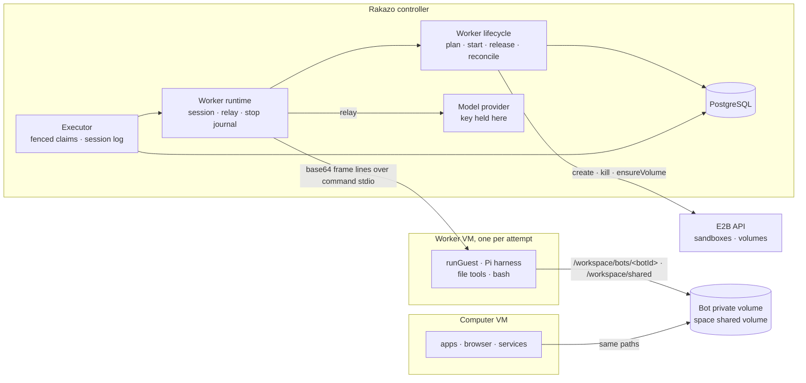

# P3 native Pi in the worker and file migration handoff

**Verdict. A run's Pi now runs in a real E2B worker, its file tools and bash work on the bot's volumes, and a second VM on the same volumes sees every write. Ten live lanes pass on the shared E2B host with no resource left behind. Four lanes wait for the composition slice (S3), which is not merged at this handoff's commit.** No composition root builds the worker runtime yet, so no product run uses a worker. The live lanes found three defects in the slices before this one, and this slice fixes them. The worker template did not build, every worker create was refused, and the home move could not reach a volume on a self-hosted E2B.

## Integrated references

- Feature base: `feature/pi-e2b-workers` at `ddcb4092e`. It contains P0, P1, P2, the multi-writer shared volume ([#224](https://github.com/RomainJeff/rakazo-bot/pull/224)) and the three earlier P3 slices: guest file tools ([#228](https://github.com/RomainJeff/rakazo-bot/pull/228)), the E2B provider, codec, bundle and template ([#229](https://github.com/RomainJeff/rakazo-bot/pull/229)), and the home move ([#241](https://github.com/RomainJeff/rakazo-bot/pull/241)).
- This slice: branch `claude/pi-e2b-p3-live`. The tested commits are in the [verification receipt](evidence/P3/verification.json).
- Composition slice (S3): branch `claude/pi-e2b-p3-compose`, not merged here. It wires tool routing into `RunNeeds`, the composition roots, reconcile, deletion, the E2B computer's volume mounts, model relay authorization and transcript redaction.
- Predecessor handoffs: [P0](P0-handoff.md), [P1](P1-handoff.md), [P2](P2-handoff.md). Infrastructure: I1, delivered in the infrastructure repository's pull request #2 (merge `177c1ff`), with its receipts at `9c1b44e` (functional) and `a38c067` (isolation). Its main branch was at `e17503b` during the runs.
- SDKs: pi-agent-core, pi-ai, pi-telemetry and pi-coding-agent 1.3.0, unchanged. The E2B SDK is `e2b@2.49.1` in the application. The E2B platform build is the one the I1 handoff records. This slice did not read it again.
- Templates: the worker template `p3live-worker-pi`, built from `apps/agent-run-worker/template` at the tested commit, and I1's `i1-computer` for the second VM. Both stay on the host.

## What P3 adds, by layer

| Layer | Slice | Files | Content |
| --- | --- | --- | --- |
| Guest tools | #228 | `apps/agent-run-worker/src/file-tools.ts`, `local-tools.ts`, `packages/adapters/src/file-tools.ts` | `list_files`, `read_file`, `write_file`, `edit_file` and `grep` run in the guest on its mounts, beside P2's `bash`, with the same results the model sees in process. |
| Provider | #229, S5 | `packages/adapters/src/e2b-worker.ts` | `E2BWorkerProvider` implements `WorkerProvider` and `GuestConnector`. One `secure` sandbox per attempt, tagged `{ rakazo: "worker", attemptId }`, volumes mounted by name. The sandbox timeout is the worker TTL, `WORKER_TTL_SECONDS`, one hour since S5. Where a deployment allows less (`maxTimeoutMs`), the provider caps it and logs a warning. |
| Codec | #229 | `packages/adapters/src/runtime-worker/framing.ts` | `encodeFrameLine` and `readFrameLines`: one base64 line per frame on stdio, replacing P2's 4-byte length prefix. E2B delivers command output through a text decoder, and base64 survives it. |
| Template | #229, S5 | `apps/agent-run-worker/template/template.ts`, `build.ts`, `scripts/bundle.ts` | Node 24 base with bash, git, procps and CA certificates, a Pi layer with ripgrep, and the guest bundle at `/opt/rakazo/agent-run-worker.mjs`. Root steps run as root, and `/workspace` belongs to the sandbox user (S5). `WORKER_PROFILE` is 1 vCPU and 1024 MiB. |
| Home move | #241, S5 | `packages/adapters/src/home-volume-migration.ts`, `e2b-volume-files.ts`, `scripts/migrate-home-to-volumes.ts` | `moveHomeToVolumes`: plan, copy, verify by hash and mode, adopt. `E2BVolumeFiles` reaches each volume through a sandbox that mounts it. It stages each file 0600 beside its target and renames it over the target, and it replaces a sandbox only once E2B proves it dead (S5). |
| Lifecycle | #241 | `packages/adapters/src/worker-lifecycle.ts` | `ensureVolume`, `provisionAttachedBotVolume`, `inspectHomeMove`, and `adoptVolumeHome` with the `space_worker_live` and `space_worker_ran` refusals. |
| Composition | S3, pending | composition roots, executor routing | Not in this handoff's commit. |
| Live lanes | S5 | `packages/testkit/src/worker-live/`, `cli/worker-live.ts`, `cli/bundle-worker-live.ts` | `pnpm test:worker-live` and `pnpm test:worker-live:bundle`. |

## Architecture

The worker and the computer are separate VMs with separate kernels. They share files only through the volumes, which E2B serves over NFS from the orchestrator, at the same paths in both VMs. The controller, the session log, the database and every key stay outside both VMs.

## Run a worker

S3 composes the runtime in the API and the job worker. Until then, the live lanes are the way to run one. They need an E2B deployment and its standard environment: `E2B_API_KEY`, and `E2B_API_URL` with `E2B_SANDBOX_URL`, or `E2B_DOMAIN`.

1. Build the worker template: `pnpm --filter @rakazo/agent-run-worker template:build --name <template>`. The build uploads the template's files to a port that a self-hosted deployment may expose on its own host only. In that case, build on that host.
2. Run the lanes: `pnpm test:worker-live lanes --template <worker template> --computer-template <computer template> --out <dir>`. Add `--lanes a,b` to pick lanes.
3. Run the bench: `pnpm test:worker-live bench --template <worker template> --computer-template <computer template> --out <dir> --trials 30`.

For a host with no checkout, `pnpm test:worker-live:bundle` writes `packages/testkit/dist/worker-live/`: the lanes as one ES module for Node 22, PGlite's assets, the migrations, the guest bundle, and the two modules the E2B SDK imports to upload template files. Copy that directory, then run `node live/bin/worker-live.mjs template --guest live/guest/agent-run-worker.mjs --name <template>` and the commands above with `node --expose-gc live/bin/worker-live.mjs` in place of `pnpm test:worker-live`. The exact sequence is in [reproduce.txt](evidence/P3/reproduce.txt).

The guest starts as `node /opt/rakazo/agent-run-worker.mjs`. `RAKAZO_WORKER_CAPABILITY` is on the command only, and the guest deletes it from its environment. `RAKAZO_WORKER_HARNESS` and `RAKAZO_WORKER_SPOOL_DIR` are on the sandbox. The spool directory is `<private mount>/.rakazo/tool-output` when the run mounts the private volume, and the guest's temporary directory otherwise.

## Tool selection and helpers

The controller puts every tool of the run in `worker.start` with its place. The guest runs six tools itself: `list_files`, `read_file`, `write_file`, `edit_file`, `grep` and `bash`. Every other tool is a `tool.call` the controller runs.

A tool missing from the run is missing from the guest's Pi. Lane d gives a run whose model cannot see images, so `computer_act` is not one of its tools. Neither the parent's nor the helper's tool list offered it, each call returned `Tool computer_act not found` to its model, and no call of it reached the controller. A guest that asks for it anyway gets `unknown_tool`, and the controller ends the run (`runtime-worker-hostile.test.ts`, offline).

A helper gets the run's tools minus `message_user` and the delegation tools in `DELEGATION_TOOL_NAMES`: `run_subagent`, `spawn_bot`, `archive_bot`, `delete_bot`, `handoff_to_bot` and `message_bot`. Removing a tool name does not remove a capability `bash` still has. A run without `write_file` can still write a file with `bash`.

## Model relay and capabilities

The guest never holds a model key, an endpoint or a connection. Every model call is a `model.request` frame in the `pi-ai` dialect, and the controller runs it with its own model and key. Lane e found the fixture key in no guest environment and no guest process's `/proc/<pid>/environ`, while three relayed calls reached the OpenAI-protocol emulator, which checks the controller's bearer key on each call.

Two relay lanes wait for S3. The emulator speaks only OpenAI chat completions, and only an `openai_compatible` connection takes a base URL, so an Anthropic-protocol model cannot point at an emulator yet. The refusal of a connection, model or endpoint the run does not grant is S3's relay authorization.

## Cleanup states

A worker is destroyed only when E2B confirms it, and a writer lease frees only in the transaction that records that. Lane g drove each fault below on real sandboxes.

| What fails | Attempt after the fault | Lease and sandbox | Run | How it ends |
| --- | --- | --- | --- | --- |
| The VM dies right after `ensure` | `released`, ref recorded | Freed, none left | Requeued, then completed on a new VM | The guest command cannot start, the attempt is unavailable, and release finds the VM gone. |
| `ensure` fails after E2B created the VM | `releasing`, no ref | Lease held, VM alive | Failed | Release cannot tell an in-flight create from none, so it waits for the ensure deadline, 15 minutes. Reconcile then destroys the VM by its attempt tag and frees the lease. The lane moved the deadline into the past instead of waiting. |
| `prepare` fails after the ref was recorded | `released`, ref recorded | Freed, none left | Failed | `start` releases its own worker at once. |
| The controller dies after `start` | `ready`, ref recorded, recorded before reconcile | Lease held, VM alive | Lease lapses | Reconcile releases it once the run's lease expires: VM destroyed, lease freed. |
| A worker outlives the sandbox timeout | `released` | Freed, none left | Requeued, then completed on a new VM | E2B killed the VM, the stream broke and release found it gone. The next attempt asked for the same `bash` call and got `its outcome is unknown`: the effect became `uncertain` and never ran again. Lane g-timeout gave the sandbox a 20 s timeout; E2B killed it about 23 s after the run started. |

The launcher turns only a lost guest into `AgentRuntimeUnavailableError`, so only that case requeues. An error from `ensure` or `prepare`, such as an E2B outage, fails the run. That is P2's launcher contract. S3 or P6 decides whether a provider error should requeue.

P2's stop contract is unchanged: `worker.cancel`, a grace of `cancelGraceMs`, then release, recorded `unconfirmed` when E2B does not confirm within `stopConfirmMs`.

## Home move, retention and rollback

Move one computer's home at a time, with the computer stopped and no worker of its space running.

1. Run `pnpm exec tsx scripts/migrate-home-to-volumes.ts --computer <id> --dry-run --template <worker template>`. The dry run creates nothing and prints the plan with any refusal.
2. Run it again with `--manifest <path>` instead of `--dry-run`. The path must not exist. It creates and provisions the volumes, writes only planned files, reads every file back and compares its sha256 and mode with the plan, then adopts. It writes the manifest once it creates anything.
3. Keep the manifest. It lists each file's home path, volume, volume path, size, sha256 and mode.
4. Recreate the computer. After adoption, nothing imports the snapshot over the volumes or exports them back. The product computer that mounts the volumes is S3's.

The command reaches each volume through a sandbox of the worker template with only that volume mounted, and destroys those sandboxes when it ends. Each file is created 0600 by the guest user, filled, given its mode, then renamed over its target; lane h checked live that an upload into a file created 0600 keeps that mode and inode. A sandbox that fails a call is replaced only on `SandboxNotFoundError`, on the SDK's "killed or reached its end of life" error, or on envd's 502 once the control plane no longer lists it. Lane h killed its three volume-file sandboxes and the next read went through a new one. It reads `DATABASE_URL`, `DATA_DIR`, and E2B's standard environment.

Lane h moved a synthetic team home of two bots, with files in mode 0755, 0644, 0640 and 0600. The dry run created no volume. The move adopted, and all six files matched the manifest by hash and mode on the volumes. Two computer VMs created one after the other on the same volumes saw the same hashes, and kept a file written between them. A second move answered `already_on_volumes`. A second team computer of the same space was refused with `volume_not_empty`, because the shared volume already held the first home's files. That closes the gap #224 left. A second team home cannot be copied into a shared volume that workers already write.

Retention. The AgentHomeStore snapshot stays as the pre-move original, and nothing writes to it after adoption. No run and no move deletes a volume. S3 deletes a bot's volumes with the bot, and a space's with the space. Guest tool output stays on the private volume under `.rakazo/tool-output/`, up to `localOutputSpoolBytes` (16 MiB) per command, and nothing removes it yet.

Rollback. Follow #241's procedure. Stop the computer, copy back any file written on the volumes since adoption, then set `computers."homeStorage"` back to `snapshot`. Files written on the volumes after adoption and not copied back are lost. The volumes stay, and a later move onto them is refused with `volume_not_empty` until they are emptied.

### Answers to #241's open questions

The live lanes settled the four questions #241 left unverified.

- **Volume path format.** E2B addresses a volume by its name. The lifecycle names it `rakazo-<volume row id>`, and the provider records that name as the volume's provider ref. A sandbox mounts the whole volume at its P1 path, `/workspace/bots/<botId>` or `/workspace/shared`.
- **Overwrite.** A second write of a path replaces its content and leaves the mode the last write set. The move never writes a path it did not plan, so it rewrites only its own interrupted copies.
- **A fresh volume is empty.** A new volume lists no entry, and the move found nothing foreign on the volumes it created.
- **Guest uid.** E2B's sandbox user is uid and gid 1001 in this template, not 1000. The Node image already has a `node` user at 1000. The moved files belong to 1001. Lane h tested one case of ownership: on the shared volume, that user read and appended to a file root had made 0600. Treat isolation as holding between volumes and VMs, not between users of one VM. Lane h did not test other modes, the private volume or other uids.

## Answers for the composition slice

S3 ([#243](https://github.com/RomainJeff/rakazo-bot/pull/243)) lists what only a live run can show. The lanes here already answer four of those points.

- **Sandbox and command environments merge.** `RAKAZO_WORKER_SPOOL_DIR` is set on the sandbox and `RAKAZO_WORKER_CAPABILITY` on the command. In lane f the guest said hello, so it read the capability, and it spooled to the private volume, so it read the spool directory.
- **The guest user writes the mounted volumes.** Lanes b and f wrote both volumes as the sandbox user, uid 1001.
- **A cold boot fits the guest deadlines.** Cold boot is 2.1 s at p95 with two mounts, against `helloDeadlineMs` (30 s) and `capabilityTtlMs` (10 minutes).
- **Reconcile releases a worker its controller lost.** Lane g released one and E2B reported the sandbox gone. Lane g calls `lifecycle.reconcile` directly, not through S3's job reconciler.

The other points need S3's code: the product computer on the volumes, its home link and volume marker, `deleteVolume`, and the relay's masked transcript. They are the pending lanes.

## Live receipts

Receipts are in `evidence/P3/`: [verification.json](evidence/P3/verification.json), [lanes.json](evidence/P3/lanes.json), [bench.json](evidence/P3/bench.json), [template.json](evidence/P3/template.json), [reproduce.txt](evidence/P3/reproduce.txt) and the [lane capture](evidence/P3/media/lanes-cli.png). Every lane ran in its own process on the shared E2B host, one at a time, after a check that no sandbox ran on the deployment and that the host had at least 1,536 MiB available. Every lane ended with no sandbox and no volume of its session left.

| Lane | Issue item | Result | Observed |
| --- | --- | --- | --- |
| a | File task identical to the baseline | Pass | `notes.md` read from the volume after the VM was destroyed is `alpha\ngamma\n`, as in process. The model saw the same seven results, and the log holds the same results. |
| b | Local tools and two-way visibility | Pass | The guest read both files the computer wrote, wrote and edited its own, and grep found both. The computer's poller saw the private write 67 ms and the shared write 75 ms after the controller granted the writing tool. |
| c | Distinct PID namespace and localhost | Pass | Each listener answered on 127.0.0.1 in its own VM and was refused from the other. Neither VM listed the other's process. The kernels' boot ids differ. |
| d | Disabled tool for parent and helper | Pass | See [Tool selection and helpers](#tool-selection-and-helpers). |
| e-openai | OpenAI-protocol relay | Pass | Three calls relayed with the controller's key. No guest process held it. |
| f | Large output kept after destruction | Pass | `seq 1 900000` printed 6,188,895 bytes. The model saw 9,918 characters and the log 4,839 bytes. The whole output was read back from the private volume with no sandbox alive, byte for byte. |
| g | Fault after provisioning | Pass | See [Cleanup states](#cleanup-states). |
| g-timeout | VM killed at its sandbox timeout | Pass | See [Cleanup states](#cleanup-states). |
| h | Move with hashes and computer recreation | Pass | See [Home move, retention and rollback](#home-move-retention-and-rollback). |
| i | Run with no files and no computer | Pass | `worker.start` had no mount and `computer: "none"`. The guest saw no NFS mount, worked in `/workspace` and could write there, and the run completed. |
| e-anthropic | Anthropic-protocol relay | Pending S3 | |
| e-refusals | Refused connection, model or endpoint | Pending S3 | |
| b-product-computer | Visibility with the product's E2B computer | Pending S3 | |
| h-product-recreate | Recreating the product's computer after a move | Pending S3 | |

## Performance

Lane j ran 30 trials of three arms, rotating which arm went first: P2's local runner in memory on the same host, an E2B worker with no mount, and an E2B worker with the private and shared volumes. Each run makes five `bash` calls, a `message_user` and the recap, through the real executor on PGlite. There were no errors in the 90 runs. All numbers are absolute. The figures below are p50 and p95. The full distributions are in [bench.json](evidence/P3/bench.json).

| Measure | Local runner | E2B, no mount | E2B, two mounts | Budget |
| --- | --- | --- | --- | --- |
| Cold boot, create to hello | | 1.70 s, 1.91 s | 1.80 s, 2.13 s | Under 30 s |
| Sandbox create | | 79 ms, 84 ms | 349 ms, 361 ms | |
| Guest boot, command start to hello | | 1.61 s, 1.82 s | 1.45 s, 1.77 s | |
| Warm run, hello to accepted end | 485 ms, 522 ms | 963 ms, 1.17 s | 1.06 s, 1.19 s | |
| Control per guest tool | 37 ms, 44 ms | 45 ms, 61 ms | 44 ms, 61 ms | |
| Relay at the controller, request to end | 11 ms, 18 ms | 9 ms, 29 ms | 9 ms, 29 ms | |
| Grant to result, one round trip and `echo` | 23 ms, 24 ms | 15 ms, 29 ms | 28 ms, 45 ms | |

**Cold boot passes its budget by a factor of 14 at p95.** The guest boot bounds it. In a fresh VM, `node -e 0` took 0.70 s and loading the 7.6 MB guest bundle 0.88 s, against 0.03 s and 0.54 s once the page cache was warm. That profile is one VM of five runs per command. The two NFS mounts add about 270 ms to the create, which matches I1's 65 ms against 350 ms.

**The relay overhead passes its 200 ms budget.** A guest's model call costs the controller-side relay plus one channel round trip. The p95 sum is 29 ms plus 29 ms, 58 ms, with no mount. The grant-to-result time also contains the `echo` itself, so it bounds the round trip from above. With the private volume mounted, it rises by about 13 ms at p50, because each `bash` call creates its spool file on NFS.

**Control per tool is PGlite on this host, not the network.** The control window is controller-side only, from `tool.call` read to `tool.grant` sent plus `tool.done` read to `tool.recorded` sent. Database calls take 97 to 99 percent of it, 17 queries at p50, as in P2. A `SELECT 1` round trip to PGlite takes 0.46 ms on this host against 0.11 ms on the machine of P2's numbers, four times slower, so P2's 6.0 ms becomes the local runner's 37 ms here. E2B adds 7 to 8 ms at p50 to the same window. This slice infers that the extra time is the frames' arrival through E2B's command stream interleaving with the window's queries, and did not trace it.

**Control cost on PostgreSQL was not measured.** The controller has to run on the E2B host, whose API listens there only. PostgreSQL there needs Docker under sudo, which the rules for the shared host exclude. P2's estimate still stands, about 17 network round trips per tool on PostgreSQL.

**The controller grew 53 MiB of RSS over 90 runs, and the growth traces to its test database.** RSS went from 1,176 to 1,229 MiB with a garbage collection before each sample, and the JS heap from 173 to 220 MiB. A heap snapshot comparison in an investigation run, not at the tested commit, found the growth in arrays of PostgreSQL wire messages held by the in-process PGlite instances, about 53,000 entries per instance after its 30 runs. That is about the number of protocol messages those runs exchanged. A controller on PostgreSQL does not hold them. Over the last ten runs, RSS grew 4.1 MiB and the heap 4.3 MiB. Each lane runs in its own process for the same reason, since one process grew about 200 MiB per lane.

The host had 8 vCPUs with a load average between 1.4 and 2.0 during the bench, from the host's other services. The arms rotated, so each saw the same load.

## Limits

- No composition root builds the worker runtime. Tool routing to `RunNeeds`, the reconcile job, deletion, the E2B computer's volume mounts, relay authorization and transcript redaction are S3's. Four lanes wait for it.
- The guest is hostile, including its Pi, which `bash` can modify. Worker frames are not a tamper-proof audit of what the guest did on its mounts. On the shared volume, the sandbox user read and appended to a root-owned 0600 file, so do not count on uids inside one VM to protect files.
- A worker lives one hour, `WORKER_TTL_SECONDS`, the limit of E2B's base plan and of a self-hosted deployment left at its default. Nothing extends it yet, so a run that outlives it loses its VM and resumes on a new attempt. A deployment that allows less sets `maxTimeoutMs`, and each capped create logs a warning.
- A guest call whose result was lost stays `executing` when the next attempt never asks for it again, even after the run completes. An earlier run of lane g-timeout showed it. It becomes `uncertain` only when a later attempt claims the same call.
- A create whose answer was lost keeps its writer lease and its VM until the ensure deadline, 15 minutes, then reconcile destroys it. Until then, the next attempt of that run is refused and requeued.
- An error from `ensure` or `prepare` fails the run instead of requeuing it.
- A broken stream during a kill in progress is logged as a lost connection.
- When another actor destroys a sandbox, the controller's `exited` for that guest stays pending. The stop is still bounded and recorded `unconfirmed`.
- An 8 MiB controller frame becomes a base64 line of about 11 MiB on stdin. No test checked it against envd's request size limit.
- A lost stdio stream ends the attempt. There is no reconnect over E2B.
- A secret that straddles a page boundary of a guest file read is not redacted. The model transcript the guest builds is not redacted by the relay. S3 owns that.
- The home move counts the space's workers to detect one that ran during the copy. Deleting a thread or a bot during the copy lowers that count and could hide such a worker.
- If the manifest write fails in the move's `finally`, its error replaces the move's report.
- A move resumes between files only. A staged `.rakazo-<uuid>` file is removed when its write fails or is cancelled, and by the retry when its sandbox died. A move process that dies mid-write still leaves one beside its target, and the next move refuses it as foreign. Remove it by hand.
- A volume-file sandbox that `close` never reached dies at its one-hour timeout. Creating one gives up after two minutes.
- A shared file overwritten before adoption is not recovered. Adoption is refused in that case.
- Guest tool output on the private volume is never cleaned up.
- The guest bundle loads in about 1.5 s on a cold VM. Warming the page cache in the template snapshot or a Node compile cache could cut it. Neither was tried.
- The lanes run the controller on PGlite. Control cost on PostgreSQL across the E2B network is not measured.
- The live bundle replaces two modules the lanes never call with stubs: Koffi, a native module the home store loads only on macOS and Windows, and jsdom, which reads its stylesheet from beside its own sources.
- The web E2E selector result is in the verification receipt. There is no user interface change, so the only capture is the lane capture.

## Entry conditions for successors

- **P4** exposes the remote tools: `computer_*`, `browser_*` and `computer.exec` stay controller tools, and every ordinary file or shell action stays local in the worker. It mounts the same volumes in the product's E2B computer at the same paths, and must not restore a snapshot over a home whose `homeStorage` is `volumes`. It decides how computer tools return images, because a controller tool's output reaches the guest as JSON.
- **P5** rebuilds a session from the durable history in `worker.start` and never from the worker's disk. The spool under `.rakazo/tool-output/` is a convenience, not the truth of a run. It reads `effectPhase` and never reruns an `uncertain` effect, and it starts no writer before `stopState` says `destroyed`. It uses the same template and launch path, and adds nothing to the guest for resume.
- **P6** starts from the measured profiles: worker 1 vCPU and 1024 MiB, computer 2 vCPU and 4096 MiB, cold boot p95 2.1 s with two mounts. It measures control cost on PostgreSQL, decides how to keep a run alive past the sandbox timeout, decides whether provider errors requeue, adds spool retention, and repeats the lanes under concurrent runs on one host.

## Rollback

This slice changes no schema. To roll it back, revert its commits. The worker TTL then returns to four hours, and the template fix, the timeout cap and the volume-files rewrite return to the code from #229 and #241, which cannot build its template, create a worker or reach a volume on the self-hosted deployment. No product run uses a worker, so nothing needs draining. The worker template `p3live-worker-pi` stays on the host until someone deletes it with `DELETE /templates/<templateId>` on the local API.
