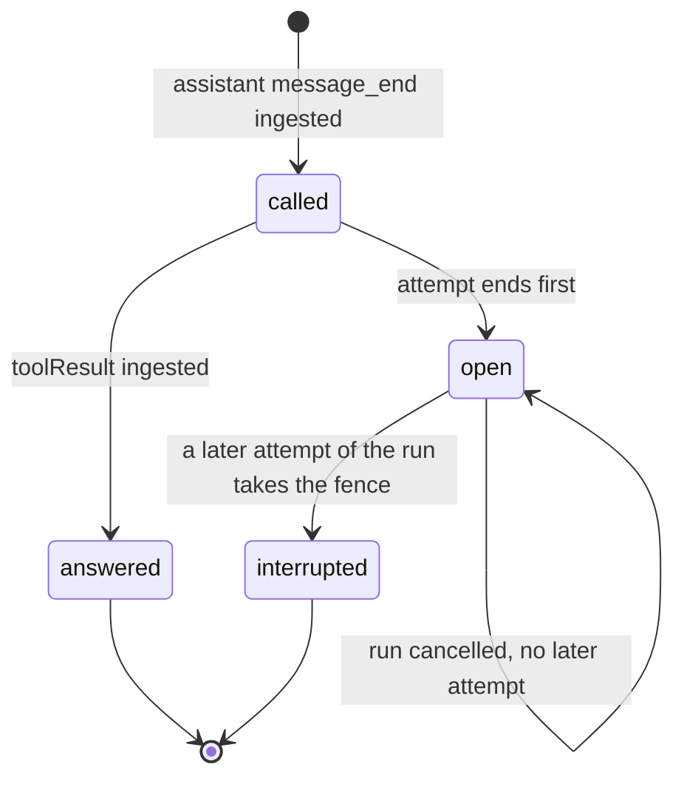

# P5 durable native work handoff

**Status: draft.** The offline contract is merged and proven. The token measurements (S2) and the live E2B receipts (S3) are not in yet. Every place that waits for them is marked `PLACEHOLDER`.

P5 makes the work of a harness with its own loop durable while the attempt runs. Before P5, the guest sent one transcript per agent at the very end of the attempt. A VM that died, a cancel, a timeout or a supersession lost every native bash the bot had already run, and the next attempt could run the same command again.

## Integrated references

- Issue: [#199](https://github.com/RomainJeff/rakazo-bot/issues/199). The plan that replaced its pre-native items moved compaction inside an attempt to the harness, and resumption to a new attempt projected from canonical history. P5 has no Pi checkpoint.
- S1, incremental transcripts: [#306](https://github.com/RomainJeff/rakazo-bot/pull/306), merged into `feature/pi-e2b-workers` at `455f4d743`.
- S2, measurements: `PLACEHOLDER: S2 pull request and merge commit`.
- S3, live lanes and this handoff: `PLACEHOLDER: S3 pull request and merge commit`.
- Predecessor: the [P4 handoff](P4-handoff.md). The controller still answers every model call through the relay, and the effect journal still owns controller tools.

## Delta transcript

The guest reports its native session through the existing `transcript` body of a `worker.event` frame. No frame type was added. Each frame carries the messages that ended since the previous frame:

```json
{
  "type": "transcript",
  "agent": "root",
  "dialect": "pi-ai",
  "messages": [
    {
      "role": "assistant",
      "content": [{ "type": "toolCall", "id": "call-1", "name": "bash", "arguments": { "command": "ls" } }]
    }
  ]
}
```

`GuestBodySchema` in `packages/adapter-kit/src/worker-protocol.ts` is strict. `messages` holds at most 4,096 entries, each with a `role`. The `systemPrompt` field is gone, because nothing read it. `agent` names a helper's session and defaults to `root`.

### What the guest sends

`apps/agent-run-worker/src/harness/pi-native.ts` reports from Pi hooks that the loop awaits:

| Pi hook | Message sent | Effect |
| --- | --- | --- |
| `message_end` of an assistant message | The message, with controller tool names mapped back | A tool call is in the controller's log before Pi runs the tool. |
| `message_end` of a `toolResult` | The result | The result reaches the log as soon as the tool ends. |
| `session_compact` | `{ role: "compactionSummary", summary, tokensBefore }` | The summary is logged as `harness.summary`. |

Each frame waits for the controller's `recorded` decision. If a report fails, the guest aborts the session instead of running on without a log. The `finally` block no longer sends a batched transcript.

### What the controller does with it

`transcriptIngest` in `packages/adapters/src/runtime-worker/transcript.ts` keeps one reducer per agent for the attempt. The session inbox already delivers frames once and in order, so frames carry no sequence number and no final flag. Each frame yields the steps it adds:

| Step | Logged by the executor as | Notes |
| --- | --- | --- |
| `call` | `tool.call` with `native: true` | Only tools in the harness's manifest from `nativeToolsForHarness`. |
| `result` | `tool.result` | Paired by `callId` with the latest open call of that id. |
| `controller` | Nothing | The controller already logged its own call and answer. A result the harness claims for it is only counted in `unverifiedCalls`. |
| `summary` | `harness.summary` | No history reads it. A later attempt replays canonical history. |
| `text` | Nothing during the attempt | The final reply is computed from all reported steps at `done`. |

`logHarnessTranscript` in `packages/adapters/src/executor.ts` appends the entries only while the attempt owns its run. Entries land in the order the harness made them, along the session chain that history replays. The D9 back-dating is deleted.

### Refusals

| Report | Refusal | Proof |
| --- | --- | --- |
| More responses and summaries than model requests the controller relayed for the agent | `budget` | `runtime-worker-transcript.test.ts`, "is refused for a response no relayed model request produced" |
| More tool results than calls the agent reported | `budget` | Same file, "is refused for a result of no reported call" |
| A native call under an id a controller call already holds | `invalid` | Same file, "is refused when it claims an id the controller already runs a call under" |
| A controller `tool.call` under an id the harness already reported as its own | `invalid` | `runtime-worker-native-transcript.test.ts`, "refuses a harness that reports its own call under a controller call's id" |
| A report from a helper that already closed | `invalid` | `runtime-worker-transcript.test.ts`, "is refused from a helper that already finished" |
| A report after the attempt lost its run | revoked | `runtime-worker-transcript.test.ts`, "is refused from an attempt that lost its run" |

One call id belongs to one side for the whole attempt. The session log pairs a result with the latest open call of its id, so a shared id would let a guest answer a controller call with a forged result.

## Native call states

A native call moves through these states in the run's session log:



- **called.** A `tool.call` with `native: true` exists and has no result.
- **answered.** The harness reported a result.
- **open.** The attempt ended without a result: VM death, timeout, cancel, supersession or controller stop.
- **interrupted.** `closeInterruptedNativeCalls` ran when a later attempt of the same run claimed the run (`claimedRun.leaseFence > 0`). It appended an error result: "The bash call was interrupted, so its outcome is unknown. It was not replayed; check the state before retrying." It closes only calls marked `native`, so a controller tool that shares a native tool's name stays with the effect journal. A second pass finds nothing open and appends nothing.

`projectInferenceTurns` in `packages/core/src/session-log/project-inference.ts` drops every `tool.call` without a result from the projected history. Without the interrupted result, the next attempt would not see the call at all and could run it again.

Reports are accepted by attempt state as follows:

| Attempt state | Report |
| --- | --- |
| Owns the fence and is running | Ingested and logged. |
| Paused on an approval and still owns the fence | Ingested and logged. |
| Started stopping (cancel, supersession, timeout, controller stop, loop guard) | Revoked. |
| Lost the fence | Revoked. |

## Crash, effect, approval and steering matrix

| Event | Run log and next attempt | Offline proof | Live proof |
| --- | --- | --- | --- |
| Worker VM dies during a native bash | The call is logged before bash starts. The next attempt closes it as interrupted, sees that result and does not replay the command. | `runtime-worker-native-transcript.test.ts`, "shows the next attempt a native call whose guest died during it as unknown, and never runs it again" | `native-kill-bash`. `PLACEHOLDER: S3 receipt` |
| E2B kills the VM at its timeout during a native bash | Same as above. The attempt ends released with its writer lease free. | Same test | `g-timeout`, P4 receipts. Its native branch predates S1. `PLACEHOLDER: S3 replay, if run` |
| User cancel during a native bash | Native work finished before the cancel stays in the log. The cut call stays without a result. No later attempt takes the run. | "keeps the native work done before a cancel, and the call it cut, without running it again" | `native-cancel`. `PLACEHOLDER: S3 receipt` |
| Another attempt supersedes the run | The new attempt closes every open native call of the earlier one before it reads history. | `executor-history.test.ts`, "closes only a harness's own call an earlier attempt cut, not a controller tool of its name" | None |
| Native and controller calls interleave | The log holds them in the order the harness made them. | "logs native and controller calls along the session in the order the harness made them"; `executor-history.test.ts`, "logs a native harness's own calls among the controller's as the attempt reports them" | None |
| Controller tool in flight when the attempt dies | The effect journal owns it. An approved effect runs once; an interrupted one is reported as unknown and not replayed. | `executor-effect-idempotency.test.ts`, `executor-approval-replay.test.ts` | `native-helper-approval`, P4 receipts |
| Approval pending, then controller restart and concurrent resumes | One approved effect, released attempts. | `runtime-worker-approvals.test.ts`, "does not run the approved call again when the controller died while running it" | `native-helper-approval` and `native-compaction`, P4 receipts |
| Pi compacts inside an attempt | `harness.summary` is logged. A later attempt replays canonical history, not the summary. | `runtime-worker-native.test.ts`, "compacts with Pi's own compaction, whose summary request goes through the relay" | `native-compaction`, P4 receipts |
| Steering claimed by an attempt that dies before delivery | The retried attempt receives the message once. | "hands a retried attempt a message its dead attempt claimed, once" | None |
| Report in flight during a controller shutdown or loop-guard stop | The report is revoked and lost. The call stays open until a later attempt closes it as interrupted. | Known limit, no test | None |
| A transcript after a supersession or cancel | Revoked. The attempt no longer owns the run. | "is refused from an attempt that lost its run" | None |

Unless a file is named, the offline tests are in `packages/testkit/src/runtime-worker-native-transcript.test.ts`. They run real Pi through the real executor on PGlite with a local worker provider.

## Live lanes

S3 adds two lanes in `packages/testkit/src/worker-live/lane-native-interrupts.ts`, registered in `LANES`. Both use the local model protocol fixture, so they prove runtime and transport behavior, not model intelligence. Both read a marker file on the private volume from a second VM, so the marker outlives the worker VM.

**`native-kill-bash`.** A native bash appends one line to `p5-started`, then sleeps for 300 seconds. When the second VM sees the marker, the lane kills the worker VM with `Sandbox.kill`, outside the product's destroy path. It passes when:

- the run log holds only the call before the kill,
- the run is queued after the kill and completes on a second attempt,
- the second attempt's first model request contains the interrupted text,
- the log holds the call and its interrupted result, and no second bash,
- the marker holds exactly one line,
- both attempts end released, and the session's sweep finds no sandbox to kill and leaves no sandbox or volume.

**`native-cancel`.** A first native bash prints `done-ok`. A second appends the marker and sleeps. When the marker appears, the lane cancels the run with `cancelRunsInTransaction`, the database write the stop button makes. It then continues the run once more. It passes when:

- the run ends `cancelled`,
- the log holds the first call and its result, then the second call without a result,
- no model request follows the cancel, and the second continue takes no attempt,
- the marker holds exactly one line,
- the single attempt ends released, and the sweep leaves nothing.

The attempt sees the cancel at its next lease heartbeat, which runs every 60 seconds. Offline, the attempt stopped 60.6 and 59.8 seconds after the cancel in two runs. The sleep outlasts that window, so the cut call is still running when the attempt stops.

### Offline proof

Both lanes ran unchanged against a local stand-in for the E2B session. The stand-in runs the real `pi-native` guest on a `LocalWorkerProvider`, maps `Sandbox.kill` to that provider's destroy, and reads the volume from its directory. Both lanes passed. Two controls failed them as expected:

- With `closeInterruptedNativeCalls` disabled, `native-kill-bash` failed. The retried request did not show the interrupted result.
- With the guest's per-message report disabled, both lanes failed. The log held no call before the kill or the cancel.

The stand-in is not committed. It proves the lane logic and the controller contract, not E2B's kill, envd's stream loss or volume visibility across VMs.

### Live receipts

`PLACEHOLDER: evidence/P5/lanes.json`, with the source commit, guest SHA-256, runner SHA-256, per-lane result, observed values and the cleanup census. Every lane must end with zero owned sandboxes and volumes.

## Measurements

`PLACEHOLDER: S2 numbers and receipts under evidence/P5/`. The protocol is in the plan for S2: OpenCode Go with GLM 5.3 flash and DeepSeek 4.1 flash, exact model IDs in the receipt, the observed cache mode of each, one real arm with the stable projection measured by the N10 instrumentation, and the estimated cost of a persistent session. Restore outside provisioning and the cost of an append are reported without a gate. If the estimate falls under the 15 % threshold, a real persistent arm is built outside P5.

## Rollback compatibility

- **The guest and the controller ship together.** A guest bundle built before #306 still sends `systemPrompt`. The strict schema rejects that body as an unrecognized key, so the controller does not accept the frame. A controller from before #306 refuses the second transcript of an agent as `invalid`, so it cannot run a guest from #306 or later either. A worker template with a baked guest from before #306 must be rebuilt, or overridden with `--guest` in the live runner. Versioning the guest artifact is planned for P6.
- **The session log stays readable both ways.** `native` is an optional field on `tool.call`. A reader from before #306 ignores it. Calls logged before #306 carry no `native` mark, so `closeInterruptedNativeCalls` never touches them. Before #306, a native call and its result were logged together, so no call was left open.
- **Back-dated entries stay as they are.** Runs logged with the D9 back-dating keep their timestamps. Nothing migrates them.

## Limits

- A report the guest sends after the controller started stopping the attempt is refused. On a user cancel or a supersession, the attempt has already lost the run by then. On a controller shutdown or a loop-guard stop, a report in flight during the stop grace is lost. The call it would have answered stays open until a later attempt closes it as interrupted.
- The call a user cancel cut stays without a result in the cancelled run's log. No later attempt takes a cancelled run. A finished run reaches later history without its tool exchanges, so nothing replays the call.
- The frame schema is strict, so a guest bundle built before #306 is refused. See rollback compatibility.
- A cancel reaches a running attempt at its next lease heartbeat, up to 60 seconds later. Native work keeps running until then.
- Pause and resume of an E2B worker during an approval is not verified.

## Reproduce

Run the worker tests with a temporary `HOME` and at most two Vitest workers. Do not run the Electron E2E suite locally.

```sh
pnpm db:generate
pnpm check
pnpm lint
HOME="$(mktemp -d)" pnpm exec vitest run --maxWorkers=2 \
  packages/testkit/src/runtime-worker-native-transcript.test.ts \
  packages/testkit/src/runtime-worker-transcript.test.ts \
  packages/adapters/src/executor-history.test.ts \
  packages/adapters/src/runtime-worker/dialects/pi-ai-history.test.ts
```

To run the live lanes, build the bundle from the tested source and upload its guest into each owned worker. A template's baked guest from before #306 is refused.

```sh
pnpm test:worker-live:bundle
E2B_API_KEY=<key> E2B_DOMAIN=<domain> pnpm test:worker-live lanes \
  --harness pi-native \
  --guest packages/testkit/dist/worker-live/guest/agent-run-worker.mjs \
  --template <worker-template> --computer-template <computer-template> \
  --out <receipt-dir> --lanes native-kill-bash,native-cancel
```

For a self-hosted deployment, set `E2B_API_URL` and `E2B_SANDBOX_URL` instead of `E2B_DOMAIN`. On a host without a checkout, copy `packages/testkit/dist/worker-live` to `<scratch>` and run `node --expose-gc <scratch>/bin/worker-live.mjs lanes` with the same options and `--guest <scratch>/guest/agent-run-worker.mjs`. The runner refuses a deployment that already runs a sandbox, runs each lane in its own process, and sweeps the session's tagged sandboxes and named volumes after each lane.

S1 changed the transcript path that every native lane uses. To replay the earlier native lanes on the same source, add `g-timeout,native-helper-approval,native-catalog,native-compaction` to `--lanes`. `PLACEHOLDER: whether that replay ran, and its receipt`.
